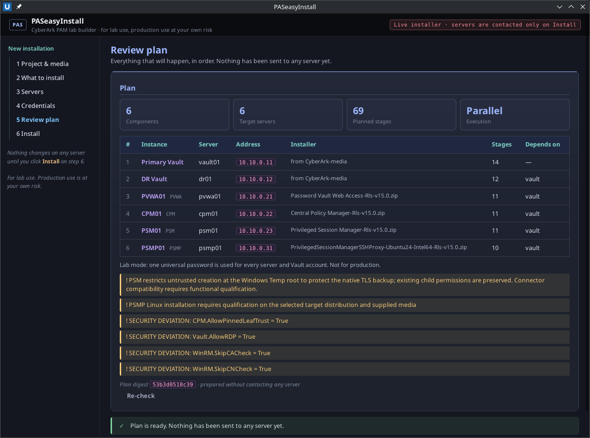

# PASeasyInstall

**Build a complete CyberArk PAM self-hosted lab from one Windows controller.** Point the desktop at your installer
media, name your servers, choose a password, and click **Install**. You get a Vault (or a replicated Primary + DR
pair), PVWA, CPM, PSM, PSMP and an optional Active Directory forest. Each component is installed, registered,
hardened and verified on its own server.

📖 **Documentation: <https://bigbatmanorg.github.io/PASeasyInstall/>**

> [!WARNING]
> **Made for labs.** PASeasyInstall is built to stand up CyberArk PAM **labs** quickly: training, demos,
> proof-of-concepts, testing upgrades and integrations. Production use is entirely at your own risk and
> responsibility. This is a community project, **not affiliated with, endorsed by or supported by CyberArk**. You
> supply your own licensed CyberArk installation media and license.



## Quick start

**Portable ZIP:** download `PASeasyInstall-<version>-portable.zip` from
[Releases](https://github.com/bigbatmanorg/PASeasyInstall/releases), unblock it, extract it, and double-click
`Start-PASeasyInstall.cmd`. Everything it needs, including the NativeHTMLKit UI runtime, is inside.

**PowerShell Gallery:**

```powershell
Install-Module PASeasyInstall -Scope CurrentUser
Start-PASeasyInstall
```

**From a script:**

```powershell
Invoke-PASeasyInstall -Config C:\Labs\Lab01.json        # a project saved by the desktop
```

Requirements, media and target preparation: [Get started](https://bigbatmanorg.github.io/PASeasyInstall/getting-started/).

## What it installs

| Component | |
|---|---|
| Vault | A new Primary Vault, or a **Primary + DR** pair with replication verified by a test Safe |
| PVWA | Prerequisites, installation, TLS (a self-signed certificate in Lab mode), registration, hardening |
| CPM | Installation, registration (trusting the PVWA certificate it is pinned to in Lab mode), hardening |
| PSM | Workgroup PSM, with the vendor's reboots handled; no plaintext autologon |
| PSMP | PSM for SSH on Ubuntu 22.04/24.04 or RHEL/Rocky 8/9 |
| Active Directory | A new forest with DNS (command line) |

You can install up to four instances of each component, put components together on one server, and install one
server at a time or in parallel. PTA is not part of this release.

## The desktop in six steps

1. **Project & media:** name the lab and drop your media. Installers are recognised even inside the CyberArk bundle ZIP.
2. **What to install:** Primary, Primary + DR or an existing Vault; how many servers of each component; the order.
3. **Servers:** the controller address, plus a hostname and address for each server.
4. **Credentials:** one lab password (Lab mode) or individual passwords. They are never saved.
5. **Review plan:** every server, installer, dependency and security deviation, before anything happens.
6. **Install:** live progress per server. Runs survive closing the window and resume safely.

Full tour with screenshots: [Desktop UI](https://bigbatmanorg.github.io/PASeasyInstall/gui/).

## How it works

A Windows PowerShell 5.1 controller drives the vendor's own installers on the targets over WinRM HTTPS (Windows) and
SSH (Linux).

- Every stage is a recorded, independently verified attempt. Interrupted runs resume from what actually happened
  on the server, and an installer is never rerun blindly.
- Passwords live only in memory.
- The desktop is a native window built with [NativeHTMLKit](https://nativehtmlkit.github.io/). There is no browser,
  web server or JavaScript.

More in [Concepts](https://bigbatmanorg.github.io/PASeasyInstall/concepts/).

## Execution policy

PASeasyInstall is not code-signed. Under the default `RemoteSigned` policy nothing extra is needed. For a portable
ZIP, run `Unblock-File` on the ZIP before extracting it. Where `AllSigned` is enforced, run:

```powershell
Set-ExecutionPolicy -Scope Process -ExecutionPolicy Bypass -Force
Start-PASeasyInstall
```

That allows unsigned code for the current PowerShell window only. Details:
[Execution policy](https://bigbatmanorg.github.io/PASeasyInstall/getting-started/execution-policy/).

## Repository layout

```text
Modules/PASeasyInstall.Core/          engine: transports, durable runs, journals, recovery, coordination
Modules/PASeasyInstall.Orchestrator/  media inventory, lab composition, plans, sequential/parallel fleet runs
Modules/PASeasyInstall.Vault|DR|PVWA|CPM|PSM|PSMP|AD/   component recipes
Modules/PASeasyInstall.UI/            the desktop (NativeHTMLKit.UI), its backend contract and a Mock backend
Modules/PASeasyInstall.PTA/           kept for future work; not part of this release
site-src/, zensical.toml              documentation site (https://bigbatmanorg.github.io/PASeasyInstall/)
Docs/                                 third-party licenses and README screenshots
Tests/, Tools/                        Pester tests and build/check tools
```

## Development

```powershell
.\Tools\Check-Modular.ps1                         # parser, manifests, sample plans; no remote operations
Invoke-Pester -Path .\Tests                       # Pester 5; some tests are Windows-only
.\Start-PASeasyInstall.ps1 -Backend Mock          # the desktop against a simulator, no servers needed
```

Documentation site: `pip install zensical==0.1.1`, then `zensical serve` (preview) or `zensical build`.
Contributor rules are in [AGENTS.md](AGENTS.md).

## License

MIT, see [LICENSE](LICENSE). Bundled third-party code: `Docs/THIRD_PARTY_*_LICENSE.txt` (MIT). CyberArk and CyberArk
product names are trademarks of CyberArk Software Ltd., used here only to describe what this tool installs.
