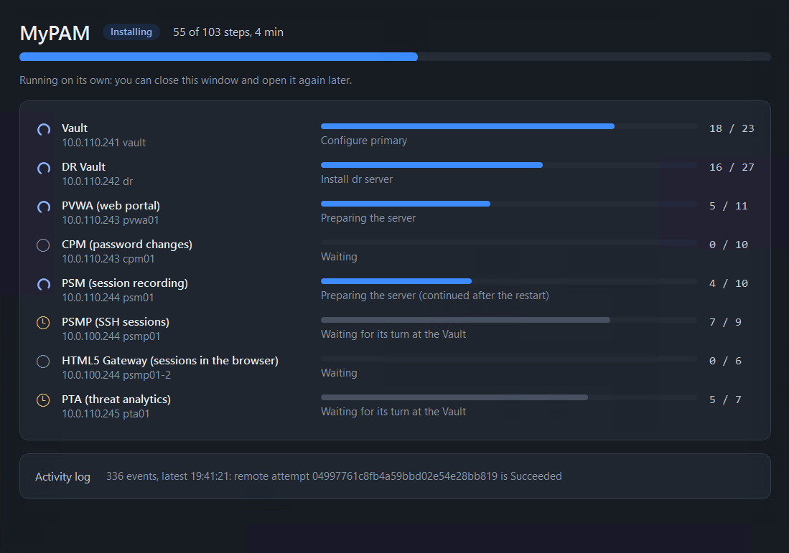
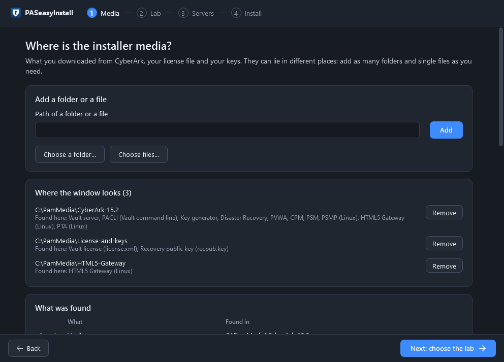

# PASeasyInstall

**Builds a CyberArk PAM self-hosted lab on servers you provide, from one Windows computer.** You point it at your
CyberArk installer media, enter the servers and press **Install**. It installs, registers, hardens and checks a
Vault (or a Primary and DR pair), PVWA, CPM, PSM, PSM for SSH, and optionally the HTML5 Gateway, PTA and an Active
Directory domain. There is a window for it and a PowerShell command for every step.

[](https://www.powershellgallery.com/packages/PASeasyInstall)
[](https://github.com/bigbatmanorg/PASeasyInstall/releases/latest)

Documentation: <https://bigbatmanorg.github.io/PASeasyInstall/> · What changed: [release notes](https://bigbatmanorg.github.io/PASeasyInstall/release-notes/)



> [!WARNING]
> **Disposable labs only:** training, demos, proofs of concept and integration tests. Production deployment is not
> supported. This is a community project. It is **not affiliated with, endorsed by or supported by CyberArk**.
> You supply your own licensed CyberArk installation media and license. No CyberArk file is part of this project.

## What you need

| | |
|---|---|
| **This computer** (the controller) | Windows with Windows PowerShell 5.1 (tested on Windows Server 2022). Nothing else: the window is part of the module and uses WPF, which is part of Windows. Free disk for a copy of the media it uses. |
| **Empty servers** | Windows Server 2022 for the Vault, DR Vault, PVWA, CPM and PSM. Ubuntu 22.04/24.04 or RHEL/Rocky 8/9 for PSM for SSH and the HTML5 Gateway. RHEL/Rocky/Alma 8/9 with 8 GB memory for PTA. 2 CPUs and 4 GB memory are enough for the others. |
| **Reachable from the controller** | Windows servers: WinRM over HTTPS (port 5986) and a local administrator. Linux servers: SSH (port 22) and the root password. |
| **Your CyberArk media** | The PAM Self-Hosted download (the one big ZIP or the separate ZIPs), your `license.xml` and the recovery public key `recpub.key`. |

The smallest lab (Vault, and PVWA with CPM on one server) needs two servers. Details:
[Requirements](https://bigbatmanorg.github.io/PASeasyInstall/getting-started/requirements/) and
[Preparing servers](https://bigbatmanorg.github.io/PASeasyInstall/servers/prerequisites/).

## Install it

**From the PowerShell Gallery:**

```powershell
Install-Module PASeasyInstall -Scope CurrentUser
Start-PASeasyInstall
```

**Or without installing anything:** download `PASeasyInstall-<version>-portable.zip` from
[Releases](https://github.com/bigbatmanorg/PASeasyInstall/releases), run `Unblock-File` on the ZIP, extract it and
double-click `Start-PASeasyInstall.cmd`.

The module is not code-signed. With the default execution policy of Windows Server (`RemoteSigned`) nothing more is
needed. Where `AllSigned` is enforced, allow unsigned code for the current PowerShell window only:

```powershell
Set-ExecutionPolicy -Scope Process -ExecutionPolicy Bypass -Force
```

## Prepare the servers

On every Windows server WinRM over HTTPS must answer. A self-signed certificate is fine for a lab:

```powershell
$cert = New-SelfSignedCertificate -DnsName $env:COMPUTERNAME -CertStoreLocation Cert:\LocalMachine\My
winrm create winrm/config/Listener?Address=*+Transport=HTTPS "@{Hostname=`"$env:COMPUTERNAME`";CertificateThumbprint=`"$($cert.Thumbprint)`"}"
New-NetFirewallRule -DisplayName 'WinRM HTTPS' -Direction Inbound -Protocol TCP -LocalPort 5986 -Action Allow
```

On every Linux server root must be able to sign in over SSH with its password once; the installer then authorises
its own key. No DNS is needed: PASeasyInstall works with addresses and writes the hosts entries the components
need.

## Your first lab, with the window

`Start-PASeasyInstall` opens the window. It has four steps.

**1. Media.** Add the folders and files where your CyberArk download, your license and your keys lie. They need
not be in one place: add one after the other, by typing a path or with **Choose a folder...** and
**Choose files...**. The window shows what it found and where. Nothing is unpacked, moved or changed.



**2. Lab.** Choose **New Vault** or **New Vault with DR**, then set with **+** and **−** how many PVWA, CPM,
PSM, PSM for SSH, HTML5 Gateway and PTA servers you want. CPM can share the PVWA server and the HTML5 Gateway the
PSM for SSH server. **Advanced** (top right) adds an Active Directory domain, an existing Vault and a few more
options.


**3. Servers.** One line per server: its computer name, its address, the account and its password. Below them the
Vault passwords to set and the license agreement of the Linux installers. **Next: check the servers** checks that
every server answers and every account can sign in. Nothing is installed yet.


**4. Install.** **Install the lab** at the top, then the plan in order and the lab shortcuts it uses. Until you press it and
confirm, nothing is changed on any server.


The installation then runs on its own, every server at the same time. You can close the window and open it again
later. When it has finished, **Check the lab** asks the Vault whether every component is connected:


Then open `https://<computer name of the PVWA server>/PasswordVault` in a browser and sign in as `Administrator`
with the Vault Administrator password you set. The PVWA certificate of a lab is self-signed, so the browser warns,
and the computer with the browser must resolve the PVWA name (a hosts entry is enough).

Every page of the window: [The window](https://bigbatmanorg.github.io/PASeasyInstall/gui/).

## The same from the prompt

```powershell
# 1. Find the installers, the license and the key. Several folders and files are fine.
$media = Get-PASMediaInventory -Path D:\CyberArk, D:\Licenses | Get-PASMediaSelection

# 2. Describe the lab. Nothing is contacted.
$cfg = New-PASLabConfiguration -Environment MyLab -VaultMode PrimaryDR `
    -PrimaryAddress 192.0.2.11 -DRAddress 192.0.2.12 -ControllerAddress 192.0.2.10 `
    -Instances @(@{ Type = 'PVWA'; Name = 'PVWA01'; Address = '192.0.2.21' },
                 @{ Type = 'CPM';  Name = 'CPM01';  Address = '192.0.2.21' },   # same address: same server
                 @{ Type = 'PSM';  Name = 'PSM01';  Address = '192.0.2.31' },
                 @{ Type = 'PSMP'; Name = 'psmp01'; Address = '192.0.2.41' }) `
    -Media $media -SecurityProfile Lab -AcceptEula
Export-PASLabConfiguration -Configuration $cfg -Path .\MyLab.json     # never contains a password

# 3. Look before you install.
Test-PASLabConfiguration -Path .\MyLab.json -CheckMedia               # is it complete?
(Get-PASLabPlan -Path .\MyLab.json).Items | Format-Table Id, Type, Address, Media
Test-PASPreflight -Path .\MyLab.json                                  # do the servers answer?

# 4. Install. Asks for the accounts and passwords, then shows the progress.
Install-PASLab -Path .\MyLab.json -Wait

# 5. Check the lab.
Test-PASHealth -Path .\MyLab.json -VaultCredential (Get-Credential Administrator)
```

One component at a time works too: `Install-PASVault`, `Install-PASPVWA`, `Install-PASCPM`, `Install-PASPSM`,
`Install-PASPSMP`, `Install-PASDomainController`. Every command has help with examples
(`Get-Help Install-PASLab -Full`). All 26 commands:
[Commands](https://bigbatmanorg.github.io/PASeasyInstall/commands/).

## What an installation does

An installation is a **run**. It runs in its own process on the controller, has a run id, and keeps going when
you close the window or the prompt.

- **The servers are installed at the same time.** Upload, checks, prerequisites, the installation itself and
  hardening need no other server, so every server starts at once.
- **Only the registrations wait.** A step that signs in to the Vault waits until the Vault is installed, and the
  components register one at a time: PVWA first, then CPM, then PSM and PSM for SSH, PTA last. The Vault
  Administrator is never used twice at once.
- **Every step is recorded and checked.** A step runs as a scheduled task (Windows) or a systemd unit (Linux) on
  the server and is verified by a separate, read-only check. If the controller closes or restarts, the step
  continues and the run finds it again.
- **Nothing is repeated blindly.** A failed step is never run again on its own. You look at the server, correct
  the cause and try that step again.

In the test lab (CyberArk 15.2) a lab of nine servers (Vault, DR Vault, PVWA, CPM, PSM, PSM for SSH, HTML5 Gateway,
PTA and the controller) took about 19 minutes from **Install the lab** to the end (2.0.11; about 21 minutes with 2.0.10).

## When something stops

The window shows the step that stopped and the installer's own error text, with **Try this step again**,
**Finish without** *the servers that failed* (they are left out, the rest of the lab is finished) and **Save the
logs as a ZIP**.


From the prompt:

```powershell
Get-PASRun                                           # all runs, newest first
Get-PASRunEvent -RunId <id> -Failed                  # what failed
Resume-PASRun -RunId <id>                            # finished steps are checked again, the rest is installed
Resume-PASRun -RunId <id> -RetryStep cpm01:install   # also run this failed step again
Resume-PASRun -RunId <id> -LeaveOut pta01            # finish the lab without the server that failed
Stop-PASRun -RunId <id>                              # abandon the run; the server locks are kept
Export-PASDiagnostics -RunId <id>                    # a ZIP without passwords for a bug report
```

Known messages and what to do: [Troubleshooting](https://bigbatmanorg.github.io/PASeasyInstall/troubleshooting/).

## What it can install

| Component | On | Notes |
|---|---|---|
| Vault | Windows Server 2022, not in a domain | A new Primary Vault, hardened the vendor's way |
| DR Vault | Windows Server 2022, not in a domain | Only together with a new Primary Vault; replication is verified with a test Safe |
| PVWA | Windows Server 2022 | With a self-signed HTTPS certificate in a lab |
| CPM | Windows Server 2022 | On the PVWA server or on its own |
| PSM | Windows Server 2022 | The vendor's restarts are handled |
| PSM for SSH | Ubuntu 22.04/24.04, RHEL/Rocky 8/9 | |
| HTML5 Gateway | Linux with Docker (Ubuntu) or Podman (RHEL family) | Can share the PSM for SSH server |
| PTA | RHEL/Rocky/Alma 8/9 with 8 GB | Registered with the Vault and PVWA; Vault events are not forwarded to it yet |
| Active Directory | Windows Server 2022 | A new forest, or a domain you have. PVWA, CPM and PSM servers are joined, Vault servers never |

Up to four instances of each component are accepted; two of each were tested.

## Limits

- **Tested with** CyberArk PAM Self-Hosted 15.0 and 15.2, Windows Server 2022, Ubuntu 24.04 and Rocky Linux 9,
  always with the **Lab** security profile. The `Secure` profile of the commands is not qualified.
- **Not included:** Vault clusters and distributed Vaults, credential providers, upgrading or removing an
  installed component.
- **Without hardening** (Advanced on the Servers step, or `New-PASLabConfiguration -SkipHardening`): everything
  is installed and registered, the vendor hardening is left out. For tests only.

What was tested in a lab, and how: [Docs/VALIDATION.md](Docs/VALIDATION.md).

## Development

```powershell
.\Tools\Check-Source.ps1                    # parser, manifest, export list equals the Public folder
.\Tools\Invoke-CITests.ps1                  # Check-Source, then the Pester 5 suite that CI runs
.\Start-PASeasyInstall.ps1 -Backend Mock    # the window with a simulated installation, no servers needed
.\Tools\Build-PortableRelease.ps1           # the Gallery package and the portable ZIP, under .\dist
```

```bash
python3 Tools/Build-CommandPages.py .       # site-src/commands/*.md from the comment-based help
python3 Tools/Check-DocLinks.py .           # links, images and command names of README.md and the site
```

```text
PASeasyInstall/            the module (no dependencies)
  Public/                  one file per command
  Private/                 configuration and planning, media, engine, run controller, diagnostics
  Recipes/                 the scripts that run on the servers
  Desktop/                 the window (WPF: XAML and PowerShell); calls only the public commands
Tests/, Tools/             Pester tests, build and check tools
LabValidation/             the lab scenarios a release is checked with
Docs/                      DESIGN.md (how a run works inside), VALIDATION.md (lab test record)
site-src/, zensical.toml   the documentation site
```

Documentation site: `pip install zensical==0.1.1`, then `zensical serve` or `zensical build`.
Rules for contributors: [AGENTS.md](AGENTS.md).

## License

MIT, see [LICENSE](LICENSE). Parts of the step engine and of the Vault recipes come from the MIT-licensed
projects PSSteps and PAS Installer; their license texts ship with the module
(`PASeasyInstall/THIRD_PARTY_*_LICENSE.txt`). CyberArk and the names of CyberArk products are trademarks of CyberArk Software Ltd.
They are used here only to describe what this tool installs.
