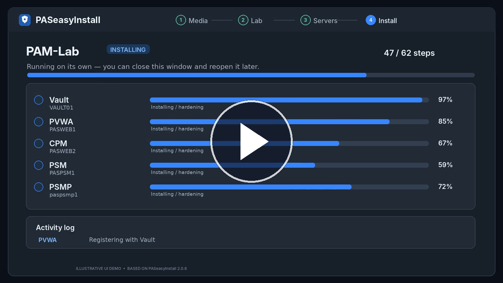
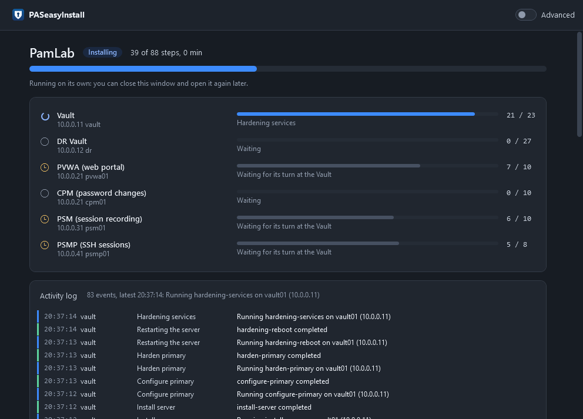
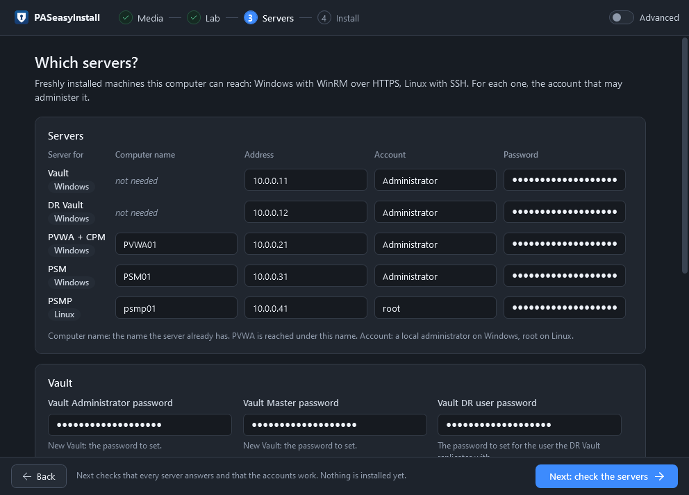
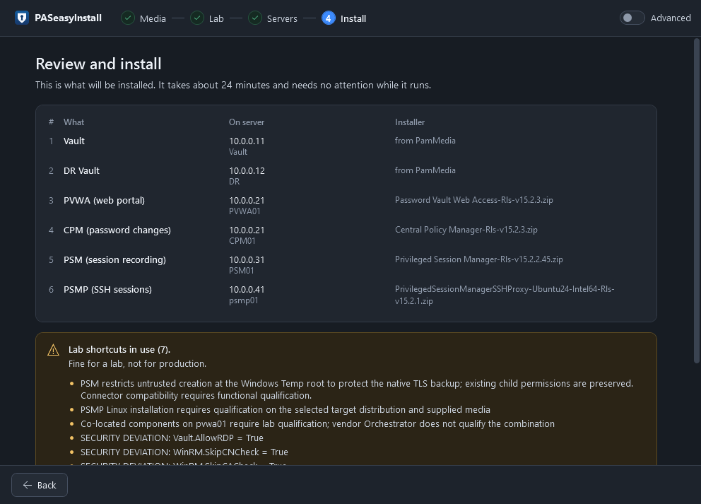
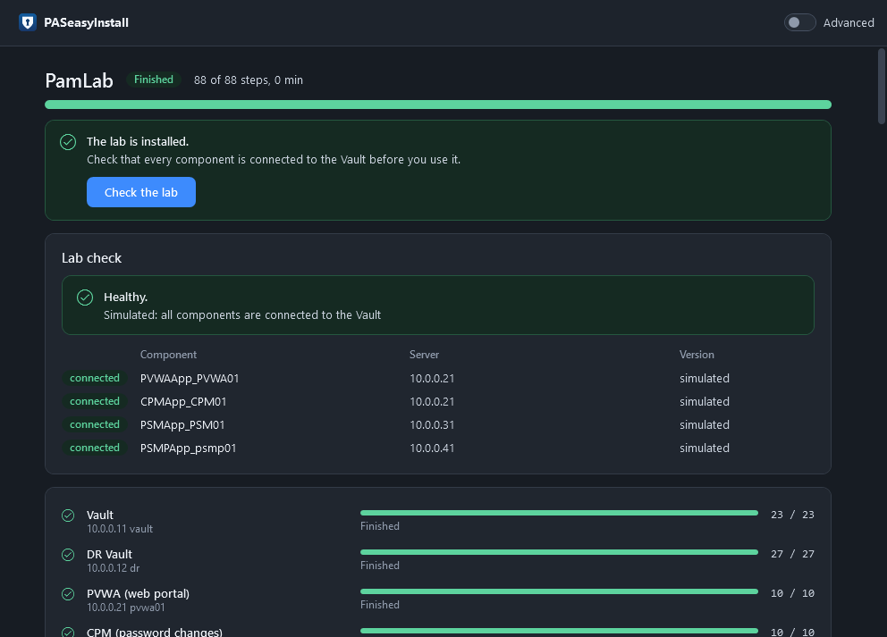
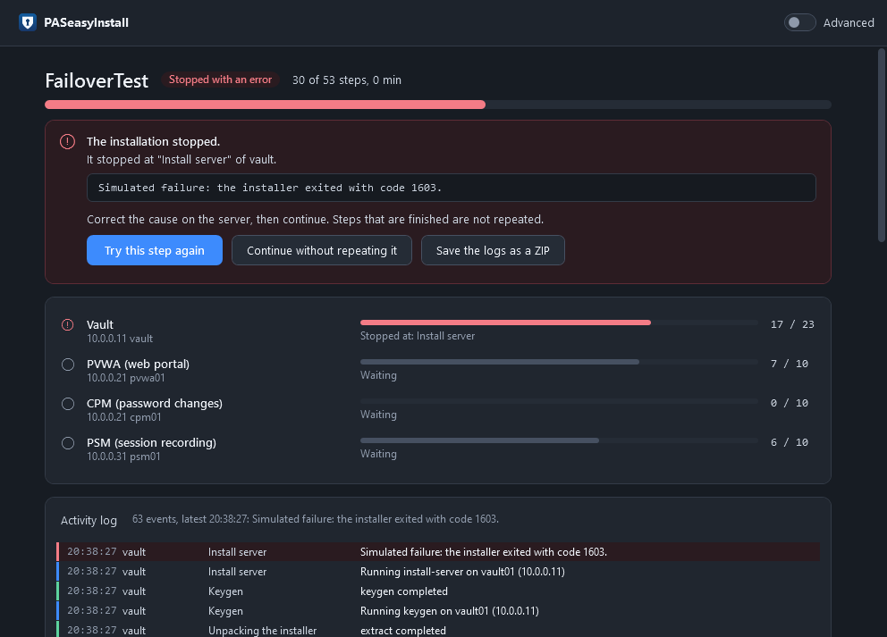

# PASeasyInstall

**Builds a CyberArk PAM self-hosted lab on servers you provide, from one Windows computer.** You point it at your
CyberArk installer media, name the servers, and press Install. It installs, registers, hardens and checks a Vault
(or a Primary and DR pair), PVWA, CPM, PSM, PSM for SSH, and optionally the HTML5 Gateway, PTA and an Active
Directory domain. There is a window for it and a PowerShell command for every step.

Documentation: <https://bigbatmanorg.github.io/PASeasyInstall/>

[](https://bigbatmanorg.github.io/PASeasyInstall/#pas-video)

*Click to play the 27-second overview on the documentation site (an animated overview with simplified screens;
[the MP4 itself](site-src/assets/video/PASeasyInstall-demo.mp4)). The real window looks like this:*



> [!WARNING]
> **Disposable labs only.** Training, demos, proofs of concept and integration testing.
> Production deployment support is not planned. This is a community project. It is **not affiliated with, endorsed by or supported by CyberArk**.
> You supply your own licensed CyberArk installation media and license. No CyberArk file is part of this project.

## What you need

| | |
|---|---|
| **This computer** (the controller) | Windows 10/11 or Windows Server 2019/2022/2025 with Windows PowerShell 5.1. Nothing else: the window is part of the module and uses WPF, which is part of Windows. About 10 GB free disk. |
| **Empty servers** | Windows Server 2022 for the Vault, DR Vault, PVWA, CPM and PSM. Ubuntu 22.04/24.04 or RHEL/Rocky 8/9 for PSM for SSH and the HTML5 Gateway. RHEL/Rocky 8/9 with 8 GB for PTA. 2 CPUs and 4 GB each are enough for a lab. |
| **Reachable from the controller** | Windows servers: WinRM over HTTPS (port 5986) and a local administrator. Linux servers: SSH (port 22) and the root password. |
| **Your CyberArk media** | The PAM Self-Hosted download (the one big ZIP or the separate ZIPs), your `license.xml` and the recovery public key `recpub.key`. |

A lab with a Vault, a DR Vault, PVWA and CPM on one server, PSM and PSM for SSH needs five servers. The smallest
lab (Vault, PVWA and CPM) needs two. Details: [Requirements](https://bigbatmanorg.github.io/PASeasyInstall/getting-started/requirements/)
and [Preparing servers](https://bigbatmanorg.github.io/PASeasyInstall/servers/prerequisites/).

## Install it

**From the PowerShell Gallery:**

```powershell
Install-Module PASeasyInstall -Scope CurrentUser
```

**Or without installing anything:** download `PASeasyInstall-<version>-portable.zip` from
[Releases](https://github.com/bigbatmanorg/PASeasyInstall/releases), run `Unblock-File` on the ZIP, extract it and
double-click `Start-PASeasyInstall.cmd`.

The module is not code-signed. With the default execution policy of Windows Server (`RemoteSigned`) nothing more is
needed. Where `AllSigned` is enforced, allow unsigned code for the current PowerShell window only:

```powershell
Set-ExecutionPolicy -Scope Process -ExecutionPolicy Bypass -Force
```

## Your first lab, with the window

Prepare the servers first. On every Windows server, WinRM over HTTPS must answer; a self-signed certificate is
fine for a lab:

```powershell
$cert = New-SelfSignedCertificate -DnsName $env:COMPUTERNAME -CertStoreLocation Cert:\LocalMachine\My
winrm create winrm/config/Listener?Address=*+Transport=HTTPS "@{Hostname=`"$env:COMPUTERNAME`";CertificateThumbprint=`"$($cert.Thumbprint)`"}"
New-NetFirewallRule -DisplayName 'WinRM HTTPS' -Direction Inbound -Protocol TCP -LocalPort 5986 -Action Allow
```

On a Linux server, root must be able to sign in over SSH with its password once. The installer then authorises
its own key.

Then, on the controller:

```powershell
Start-PASeasyInstall
```

**1. Media.** Add the folders and files where your CyberArk download, your license and your keys lie. They do not
have to be in one place: add one after the other, by typing a path or with **Choose a folder...** and
**Choose files...**. The window looks through all of them and shows what it found and where. Nothing is unpacked,
moved or changed.


**2. Lab.** Choose **Primary Vault** or **Primary + DR Vault**, then use the `+`/`−`
counters to select PVWA, CPM, PSM, PSM for SSH, HTML5 Gateway and PTA. There are no
Starter/Standard/Full workflows: component counts are the normal path. CPM can share the PVWA
server, and HTML5 Gateway can share a PSMP server. The **Advanced** switch optionally exposes
Active Directory, an existing Vault, and specialized options. You can start with the defaults.

Updated desktop screenshots should be captured during S01 validation; older screenshots showing preset cards are obsolete.

**3. Servers.** One line per server: its computer name, its address, the account and its password. Below it, the
Vault passwords to set. **Next** checks that every server answers and that every account can sign in. Nothing is
installed yet.



**4. Install.** The plan in order, the shortcuts the lab uses, and the **Install the lab** button. Until you press
it and confirm, nothing is changed on any server.



The installation then runs on its own. You can close the window and open it again later. When it has finished,
**Check the lab** asks the Vault whether every component is connected.



Then open `https://<computer name of the PVWA server>/PasswordVault` in a browser and sign in as `Administrator`
with the Vault Administrator password you set. In a lab the PVWA certificate is self-signed, so the browser warns,
and the computer with the browser must resolve the PVWA name (a hosts entry is enough).

Every page of the window: [The window](https://bigbatmanorg.github.io/PASeasyInstall/gui/).

## The same from the prompt

```powershell
# 1. Find the installers, the license and the key. Several folders and files are fine.
$media = Get-PASMediaInventory -Path D:\CyberArk, D:\Licenses | Get-PASMediaSelection

# 2. Describe the lab. Nothing is contacted.
$cfg = New-PASLabConfiguration -Environment MyLab -VaultMode PrimaryDR `
    -PrimaryAddress 192.0.2.11 -DRAddress 192.0.2.12 -ControllerAddress 192.0.2.10 `
    -Instances @(@{ Type = 'PVWA'; Name = 'PVWA01'; Address = '192.0.2.21' },
                 @{ Type = 'CPM';  Name = 'CPM01';  Address = '192.0.2.21' },
                 @{ Type = 'PSM';  Name = 'PSM01';  Address = '192.0.2.31' },
                 @{ Type = 'PSMP'; Name = 'psmp01'; Address = '192.0.2.41' }) `
    -Media $media -SecurityProfile Lab -AcceptEula
Export-PASLabConfiguration -Configuration $cfg -Path .\MyLab.json     # never contains a password

# 3. Look before you install.
Test-PASLabConfiguration -Path .\MyLab.json -CheckMedia               # is it complete?
(Get-PASLabPlan -Path .\MyLab.json).Items | Format-Table Id, Type, Address, Media
Test-PASPreflight -Path .\MyLab.json                                  # do the servers answer?

# 4. Install. Asks for the accounts and passwords, then shows the progress.
Install-PASLab -Path .\MyLab.json -Wait

# 5. Check the lab.
Test-PASHealth -Path .\MyLab.json -VaultCredential (Get-Credential Administrator)
```

One component at a time works too: `Install-PASVault`, `Install-PASPVWA`, `Install-PASCPM`, `Install-PASPSM`,
`Install-PASPSMP`, `Install-PASDomainController`. With `-SecurityProfile Lab` one password can serve for
everything: `-LabPassword (Read-Host -AsSecureString 'Lab password')`. Every command has help with examples:
`Get-Help Install-PASLab -Full`. All 26 commands:
[Commands](https://bigbatmanorg.github.io/PASeasyInstall/commands/).

## What an installation does

An installation is a **run**. It executes in its own process on the controller, has a run id, and keeps going
when you close the window or the prompt.

- **The servers are installed at the same time.** Upload, checks, prerequisites, the installation itself and
  hardening need no other server, so every server starts at once.
- **Only the registrations wait.** A step that signs in to the Vault waits until the Vault is installed. Then the
  components register one at a time, PVWA first, then CPM, then the others, so the Vault Administrator is never
  used twice at once.
- **Every step is recorded and checked.** A step runs as a scheduled task (Windows) or a systemd unit (Linux) on
  the server and is verified by a separate, read-only check. If the controller closes or restarts, the step
  continues and the run finds it again.
- **Nothing is repeated blindly.** A step that failed is never run again on its own. You look at the server,
  correct the cause and name the step.

In the test lab (CyberArk 15.2) a lab with Vault, PVWA, CPM on its own server, PSM and PSM for SSH took 19
minutes; a Full lab with a DR Vault took 23 minutes and a lab with a new domain 20 minutes (both measured with
2.0.5). `New-PASLabConfiguration -ExecutionMode Sequential` installs one component after the other instead.

## When something stops

The window shows the step that stopped and the installer's own error text, with **Try this step again**,
**Continue without repeating it** and **Save the logs as a ZIP**.



From the prompt:

```powershell
Get-PASRun                                           # all runs, newest first
Get-PASRunEvent -RunId <id> -Failed                  # what failed
Resume-PASRun -RunId <id>                            # finished steps are checked again, the rest is installed
Resume-PASRun -RunId <id> -RetryStep cpm01:install   # also run this failed step again
Stop-PASRun -RunId <id>                            # abandon run; KEEP remote target locks
# ONLY after restoring/rebuilding affected lab VMs:
Stop-PASRun -RunId <id> -ReleaseLocksAfterReset -CredentialMap $creds
Export-PASDiagnostics -RunId <id>                    # a ZIP without passwords for a bug report
```

Known messages and what to do: [Troubleshooting](https://bigbatmanorg.github.io/PASeasyInstall/troubleshooting/).

## What it can install

| Component | On | Notes |
|---|---|---|
| Vault | Windows Server 2022, not in a domain | New Primary Vault, hardened with the vendor's hardening |
| DR Vault | Windows Server 2022, not in a domain | Only together with a new Primary Vault; replication is verified with a test safe |
| PVWA | Windows Server 2022 | In a lab with a self-signed HTTPS certificate |
| CPM | Windows Server 2022 | On the PVWA server or on its own |
| PSM | Windows Server 2022 | The vendor's restarts are handled; no stored autologon password |
| PSM for SSH (PSMP) | Ubuntu 22.04/24.04, RHEL/Rocky 8/9 | |
| HTML5 Gateway | Linux with Docker (Ubuntu) or Podman (RHEL family) | Can share the PSMP server. Experimental |
| PTA | RHEL/Rocky 8/9 with 8 GB | Experimental; Vault events are not forwarded to it yet |
| Active Directory | Windows Server 2022 | A new forest, or joining a domain you have. PVWA, CPM and PSM servers are joined; Vault servers never |

Up to four instances of each component are accepted; two of each were tested.

## Limits

- **Tested with** CyberArk PAM Self-Hosted 15.0 and 15.2, Windows Server 2022, Ubuntu 24.04 and Rocky Linux 9,
  always with the **Lab** security profile. The legacy Secure CLI settings are unqualified;
  implementing a production/Secure deployment mode is not planned.
- **The window** was tested by script, also with real installations. It has not been tried by hand on a real
  desktop for every screen. It always uses the Lab profile.
- **Not included:** Vault clusters and distributed Vaults, credential providers, upgrading or removing an
  installed component.
- **Without hardening:** the window (Advanced on the Servers step) and `New-PASLabConfiguration -SkipHardening`
  install and register everything but leave out the vendor hardening. For tests only.

What exactly was tested, with which version and how: [Docs/STATUS.md](Docs/STATUS.md).

## More

- [Documentation site](https://bigbatmanorg.github.io/PASeasyInstall/): getting started, the window page by page,
  every command, every component, how it works, troubleshooting.
- [Docs/STATUS.md](Docs/STATUS.md): what works, what is experimental, what comes later.
- [Docs/DESIGN.md](Docs/DESIGN.md): how a run works inside and which files it leaves behind.
- [Release notes](https://bigbatmanorg.github.io/PASeasyInstall/release-notes/).

## Stability candidate and Proxmox lab validation

This source ZIP contains a **lab-only stability candidate**, not a proven release. It adds
readiness-driven parallel integrations, durable verification-only recovery, safer forced-stop
lock retention, frozen Vault recipes, explicit Linux package preparation and DR progress events.
The desktop now uses a single media → component counts → servers → install flow.

Review [stabilization details](Docs/LAB-STABILIZATION.md) and the
[autonomous Proxmox validation prompt](LabValidation/AGENT-PROMPT.md) with its eight focused
[scenarios](LabValidation/scenarios.json). No CyberArk media, credentials or test VM images
are distributed with this project.

## Development

```powershell
.\Tools\Check-Source.ps1                    # parser, manifest, export list equals the Public folder
.\Tools\Invoke-CITests.ps1                  # Check-Source, then the Pester 5 suite that CI runs
.\Start-PASeasyInstall.ps1 -Backend Mock    # the window with a simulated installation, no servers needed
.\Tools\Build-PortableRelease.ps1           # the Gallery package and the portable ZIP, under .\dist
```

```text
PASeasyInstall/            the module (no dependencies)
  Public/                  one file per command
  Private/                 configuration and planning, media, engine, run controller, diagnostics
  Recipes/                 the scripts that run on the servers
  Desktop/                 the window (WPF: XAML and PowerShell); calls only the public commands
Tests/, Tools/             Pester tests, build and check tools
Docs/                      DESIGN.md, STATUS.md, screenshots
site-src/, zensical.toml   the documentation site
```

Documentation site: `pip install zensical==0.1.1`, then `zensical serve` or `zensical build`.
Rules for contributors: [AGENTS.md](AGENTS.md).

## License

MIT, see [LICENSE](LICENSE). CyberArk and the names of CyberArk products are trademarks of CyberArk Software Ltd.
They are used here only to describe what this tool installs.
