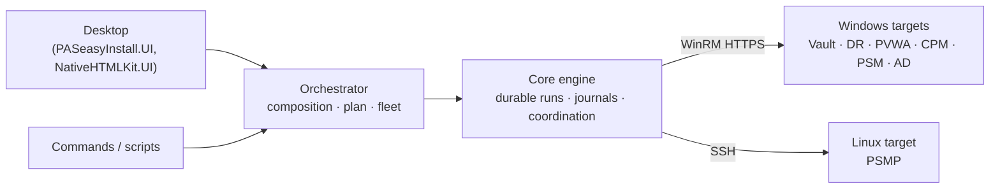

# Architecture

- **PASeasyInstall.UI** is the desktop. It talks to the backend only through a small, documented contract, and the
  same window runs against the real installer or the Mock simulator.
- **PASeasyInstall.Orchestrator** handles media inventory, composition of a whole lab, the plan, and the *fleet
  controller* that runs the Vault (+DR) first and then each component server, sequentially or in parallel.
- **PASeasyInstall.Core** is the engine. It owns transports (WinRM HTTPS, SSH), frozen workflows, the event journals,
  recovery and coordination.
- **Component modules** (Vault, DR, PVWA, CPM, PSM, PSMP, AD) contain the recipes. Each can be imported and used on its
  own with Core, without the UI.

Everything runs in **Windows PowerShell 5.1** on the controller. There is no web server, database, browser engine or
agent installed permanently on the targets. The vendor's own installers, hardening and registration scripts do the
product work.

## What runs where

| On the controller | On a target |
|---|---|
| Planning, validation, media resolution and caching | Staged media (hash-verified) in a protected workspace |
| A **detached controller process** per deployment (survives closing the window) | Each stage as a **scheduled task running as SYSTEM** (Windows) or a **systemd unit** (Linux) with a unique attempt ID |
| Event journals under `%LOCALAPPDATA%\PASeasyInstall` | A restricted WinRM endpoint usable only by the configured administrator |
