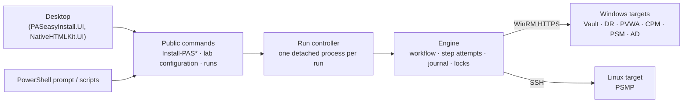

# Architecture

There are two modules:

- **PASeasyInstall** is the core. It has no dependencies. It exports 25 [commands](../commands/index.md); everything
  else is private. Inside it:
    - `Public` has one file per command;
    - `Private\Config` reads, validates and composes configurations and builds the plan;
    - `Private\Run` is the **run controller**. It installs the components of a run one after the other: Active
      Directory, domain joins, Vault (and DR), then PVWA, CPM, PSM, PSMP;
    - `Private\Engine` runs one workflow on one server: transports (WinRM HTTPS, SSH), step attempts, the journal
      and the locks;
    - `Recipes` holds the scripts that run on the servers.
- **PASeasyInstall.UI** is the desktop. It calls only the public commands, and the same window runs against the
  real module or the Mock simulator.

Everything runs in **Windows PowerShell 5.1** on the controller. There is no web server, database, browser engine or
agent installed permanently on the targets. The vendor's own installers, hardening and registration scripts do the
product work.

## What runs where

| On the controller | On a target |
|---|---|
| Planning, validation, media resolution and caching | Staged media (hash-verified) in a protected workspace |
| A **detached controller process** per run (survives closing the console or the window) | Each step as a **scheduled task** (Windows) or a **systemd unit** (Linux) with a unique attempt ID |
| Run files under `%LOCALAPPDATA%\PASeasyInstall\Runs\<run id>` | A restricted WinRM endpoint usable only by the configured administrator |

The repository file `Docs/DESIGN.md` lists every file a run leaves on the controller and on a target.
