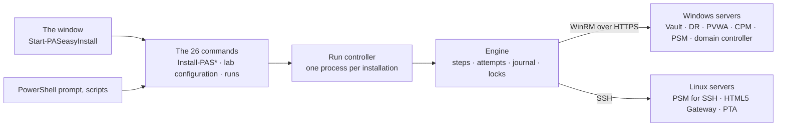

# The parts

**One module.** PASeasyInstall is one PowerShell module without dependencies. It exports 26
[commands](../commands/index.md); everything else is private. The window is a folder of the same module and
calls only those commands.

**One controller.** Everything runs in Windows PowerShell 5.1 on the controller. There is no server component,
no database, no web server, and no agent that stays on the servers.

**The vendor does the product work.** The Vault, PVWA, CPM, PSM, PSM for SSH, the gateway and PTA are installed,
registered and hardened by CyberArk's own installers and scripts from your media. PASeasyInstall brings the files
to the server, fills in the answer files, starts the vendor's tools in the right order, and checks the result.

## What runs where

| On the controller | On a server |
|---|---|
| Finding media, composing and checking the configuration, the plan | The installer package, verified by its SHA-256, in a protected work folder |
| **One controller process per installation.** It keeps running when the window or the prompt is closed | Each step that changes something, as a **scheduled task** (Windows) or a **systemd unit** (Linux) with its own id |
| The journals of the installation, in `%LOCALAPPDATA%\PASeasyInstall\Runs\<run id>` | The state of each step, so that it is found again after an interruption |
| The cache of installers taken out of a big ZIP, and the SSH key for Linux servers | A restricted WinRM endpoint that only the configured administrator may use (Windows) |

## From a click to a step

1. **Configuration.** The window, or `New-PASLabConfiguration`, composes a configuration: what to install where,
   with which installer. It holds no password.
2. **Plan.** `Get-PASLabPlan` shows what the configuration would install. Nothing is contacted.
3. **Run.** `Install-PASLab` checks the configuration and the installers, asks for the accounts and passwords,
   and starts the controller process. The configuration and the plan are frozen with the run.
4. **Lanes.** The controller gives every server its own lane and runs the lanes at the same time
   ([Servers at the same time](parallel.md)).
5. **Steps.** In a lane, the engine runs the steps of each component in order. A step is started on the server,
   watched, and then verified by a separate, read-only check.
6. **Journal.** Before a step is started and after every outcome, its state is written down. The window and
   `Get-PASRun` only read these files.

The repository file
[Docs/DESIGN.md](https://github.com/bigbatmanorg/PASeasyInstall/blob/main/Docs/DESIGN.md) lists every file a run
leaves on the controller and on a server.
