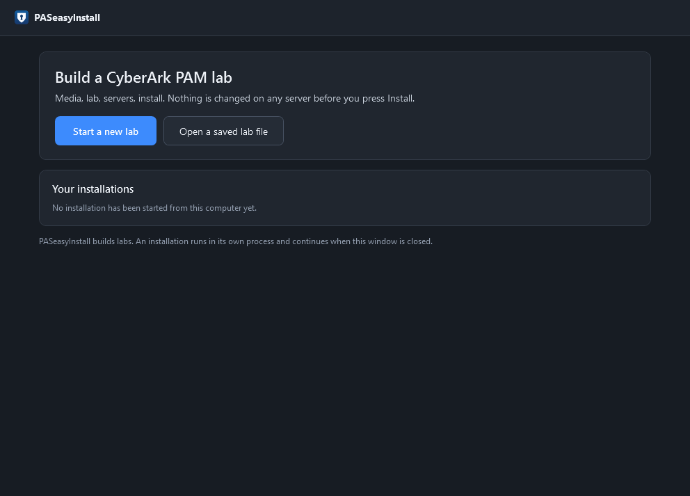
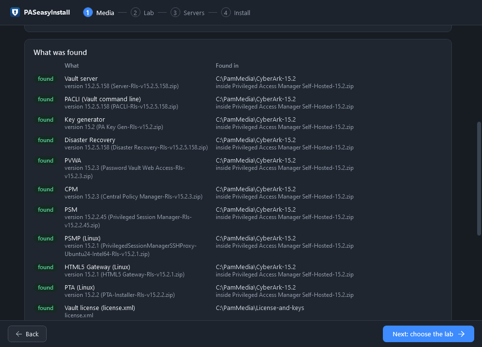
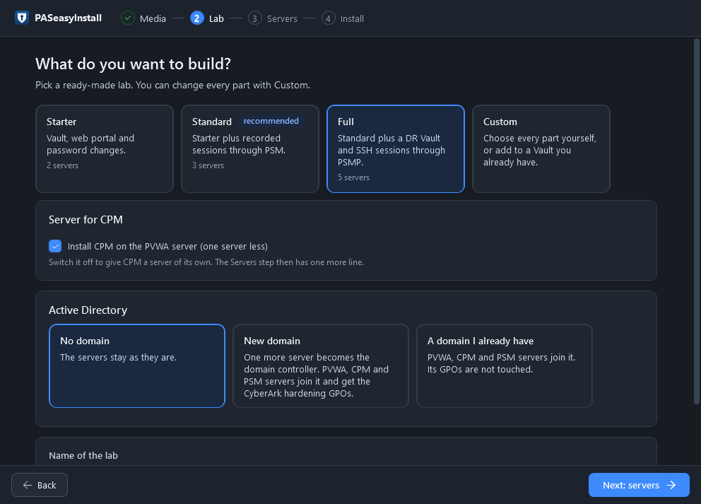
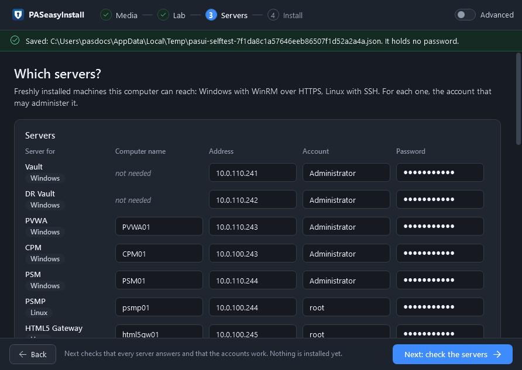
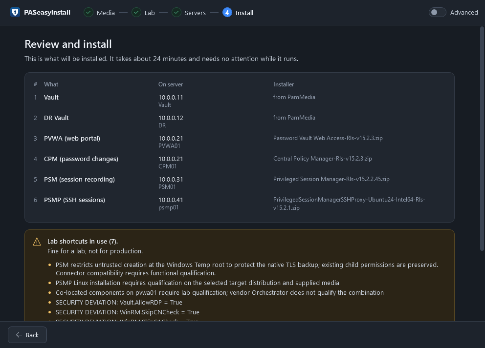
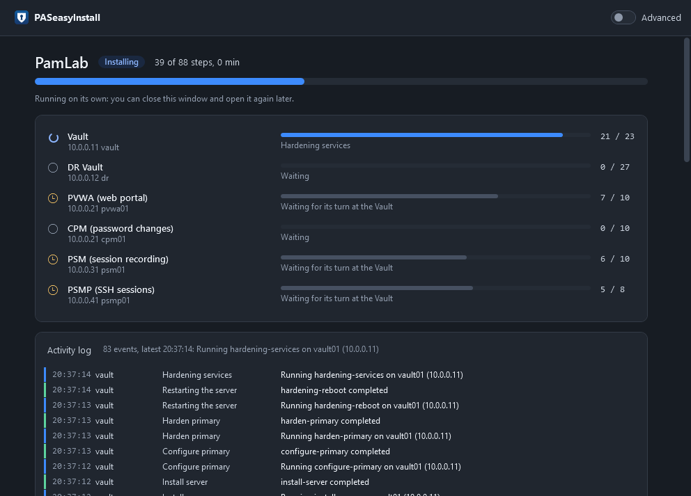
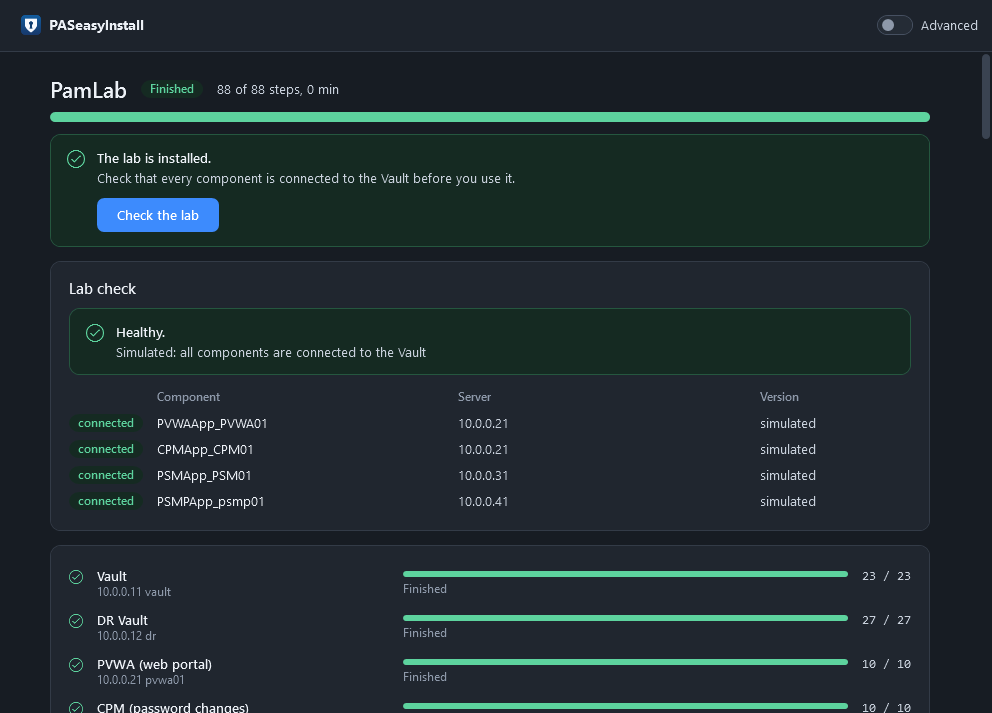

# Your first lab

This page builds a small, complete lab with the window: a Vault, PVWA with CPM on one server, PSM, and PSM for
SSH. It needs four servers and the controller. A larger lab works the same way: you only set other numbers on
the Lab step and fill in more lines on the Servers step.

The names and addresses below are examples. Use your own.

| Server | Computer name | Address | Operating system |
|---|---|---|---|
| Controller | (this computer) | 192.0.2.10 | Windows with Windows PowerShell 5.1 |
| Vault | any | 192.0.2.11 | Windows Server 2022, not in a domain |
| PVWA and CPM | PVWA01 | 192.0.2.21 | Windows Server 2022 |
| PSM | PSM01 | 192.0.2.31 | Windows Server 2022 |
| PSM for SSH | psmp01 | 192.0.2.41 | Ubuntu 24.04 |

## 1. Prepare the servers

Install the operating systems, and give every server its computer name and a fixed address. Take a snapshot of
each server now: an installation cannot be undone, and the snapshot is how you start again.

On every **Windows** server, make WinRM answer over HTTPS. A self-signed certificate is fine for a lab:

```powershell
$cert = New-SelfSignedCertificate -DnsName $env:COMPUTERNAME -CertStoreLocation Cert:\LocalMachine\My
winrm create winrm/config/Listener?Address=*+Transport=HTTPS "@{Hostname=`"$env:COMPUTERNAME`";CertificateThumbprint=`"$($cert.Thumbprint)`"}"
New-NetFirewallRule -DisplayName 'WinRM HTTPS' -Direction Inbound -Protocol TCP -LocalPort 5986 -Action Allow
```

On the **Linux** server, root must be able to sign in over SSH with its password once. On a cloud image that
usually means setting a root password and allowing it while you install:

```bash
sudo passwd root
echo 'PermitRootLogin yes' | sudo tee /etc/ssh/sshd_config.d/01-install.conf
echo 'PasswordAuthentication yes' | sudo tee -a /etc/ssh/sshd_config.d/01-install.conf
sudo systemctl restart ssh
```

More, and how to test a server by hand: [Server prerequisites](../servers/prerequisites.md).

## 2. Put the media on the controller

Copy your CyberArk download, `license.xml` and `recpub.key` to the controller. They can lie in different
folders, for example `D:\CyberArkMedia` for the download and `D:\Licenses` for the license and the key.

## 3. Open the window

```powershell
Start-PASeasyInstall
```

From the portable ZIP: double-click `Start-PASeasyInstall.cmd`.

The start page lists **Your installations** (empty the first time). Press **Start a new lab**. The top bar now
shows the four steps: 1. Media, 2. Lab, 3. Servers, 4. Install. A finished step can be pressed to go back to
it.



### 1. Media

Type the path of the folder with your download into **Path of a folder or a file** and press **Add**, or use
**Choose a folder...** or **Choose files...**. Add the folder with the license and the key the same way.

The window lists every place under **Where the window looks**, with what it found there, and below it **What
was found**: one line per part (Vault server, PACLI, PVWA, CPM, PSM, PSMP, license, recovery key, ...) with
*found* or *not found*, its version and where it lies. When every part of the chosen lab is there, it says
**Everything the chosen lab needs was found.**



Press **Next: choose the lab**.

### 2. Lab

Choose **New Vault**. Under **Components**, use **-** and **+** to set PVWA, CPM, PSM and PSMP (SSH sessions)
to 1, and HTML5 Gateway and PTA to 0. Leave **Install CPM on the PVWA server (one server less)** ticked. Give the
lab a name under **Name of the lab**, for example `PamLab`.



Without **Advanced**, each counter goes up to 2. **New Vault with DR** adds a DR Vault server. An Active
Directory domain and **Use existing Vault (advanced)** appear when you switch on **Advanced** in the top bar.
See [2. Lab](../gui/lab.md).

Press **Next: servers**.

### 3. Servers

The table has one line per server. Enter the **Computer name** where the window asks for one (the name the
server already has), the **Address** and the **Password**. The **Account** is `Administrator` on Windows and
`root` on Linux unless you change it.

Under **Vault**, type the passwords to set for the Vault users: **Vault Administrator password** and **Vault
Master password** (and **Vault DR user password** in a lab with a DR Vault). Because the lab has a PSM for SSH,
tick the box that accepts the CyberArk license agreement of the Linux installers.



Passwords are kept in memory only. **Save the lab file...** keeps everything else as a JSON file, so that you can
open it later with **Open a saved lab file** on the start page.

Press **Next: check the servers**. Nothing is installed yet. The window first looks whether every server
answers, then signs in to each one and checks that it is ready. A server that does not answer, or a password
that is wrong, is listed with the reason under **The servers are not ready.** Correct it and press **Next**
again. When all servers pass, the window moves on by itself.

### 4. Install

**Review and install** lists what will be installed, on which server, with which installer, and about how
many minutes it takes. **Lab shortcuts in use** lists what the Lab profile relaxes on purpose (see
[Made for labs](../lab-first.md)).



Press **Install the lab**, then **Install** in the question that follows.

## 4. Watch it run

The installation page opens. It shows the lab name, the number of steps done, and one line per component with
its current step. Every server starts at once: PVWA, PSM and PSM for SSH are prepared on their servers while the
Vault is installed. A component that is ready to register shows **Waiting for its turn at the Vault** until the
Vault is ready; then the components register one at a time.



PSM restarts its server during the installation. That is expected. You can close the window: the installation
runs in its own process, and the start page lists it when you open the window again. If you open it again
while the installation runs, the window asks for the passwords again when it needs them, because it never
stores them.

## 5. Check the lab

When the page says **The lab is installed.**, press **Check the lab**. It signs in to the Vault through PVWA
(with the Vault Administrator password) and lists, under **Lab check**, each component the Vault knows with
*connected* or *not connected*, its server and its version.



Then open the web portal: `https://PVWA01/PasswordVault`. Sign in as `Administrator` with the Vault
Administrator password you set. Two things to know in a lab:

- The computer with the browser must resolve the PVWA computer name. A line in its hosts file is enough:
  `192.0.2.21 PVWA01`.
- The PVWA certificate is self-signed, so the browser warns. Accept it, or import the certificate.

## If it stops

The page says **The installation stopped.**, names the step and the component, and shows the installer's own
error text. Correct the cause on the server, then press **Try this step again**. Steps that are finished are not
repeated. A server that cannot be installed now, such as a PTA server, can be left out instead: **Finish without**
*its name* finishes the rest of the lab. See [The installation page](../gui/run.md) and [Troubleshooting](../troubleshooting/index.md).

## The same lab from the prompt

```powershell
$media = Get-PASMediaInventory -Path D:\CyberArkMedia, D:\Licenses | Get-PASMediaSelection
$cfg = New-PASLabConfiguration -Environment PamLab -VaultMode Primary `
        -PrimaryAddress 192.0.2.11 -ControllerAddress 192.0.2.10 `
        -Instances @(@{ Type = 'PVWA'; Name = 'PVWA01'; Address = '192.0.2.21' },
                     @{ Type = 'CPM';  Name = 'CPM01';  Address = '192.0.2.21' },
                     @{ Type = 'PSM';  Name = 'PSM01';  Address = '192.0.2.31' },
                     @{ Type = 'PSMP'; Name = 'psmp01'; Address = '192.0.2.41' }) `
        -Media $media -SecurityProfile Lab -AcceptEula
Export-PASLabConfiguration -Configuration $cfg -Path .\PamLab.json

Test-PASPreflight -Path .\PamLab.json          # do the servers answer?
Install-PASLab -Path .\PamLab.json -Wait       # asks for the accounts and passwords, then installs
Test-PASHealth -Path .\PamLab.json -VaultCredential (Get-Credential Administrator)
```

Two instances with the same address share one server, as PVWA and CPM do here. Pass `-SecurityProfile Lab`:
the default of `New-PASLabConfiguration` is the Secure profile, which was not tested. Each command is
explained in [Commands](../commands/index.md). With **Advanced** switched on, the Install step of the window
shows the commands for the lab you chose.
