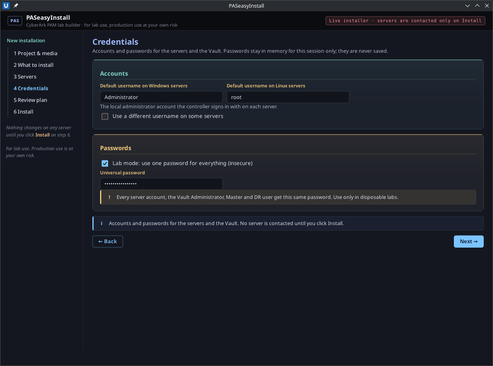
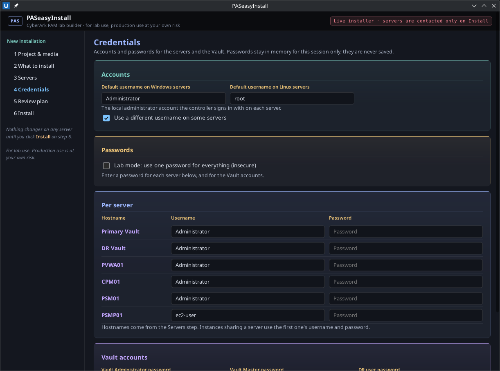

# 4 Credentials

Passwords stay in memory for this session only. They are never written to the project file, logs or journals.

## Accounts

- **Default username on Windows servers:** `Administrator`. This is the local administrator account the controller
  signs in with. A plain name is used as the target's **local** account (`.\Administrator`).
- **Default username on Linux servers:** `root`.
- **Use a different username on some servers** shows a per-server table.

## Lab mode

**Lab mode** uses one universal password for every server and for the Vault Administrator, Master and DR users. It
also selects the **Lab** security profile: self-signed certificates are accepted, the Vault allows RDP from the
controller, and CPM pins the PVWA's self-signed certificate. See [Lab and Secure profiles](../concepts/profiles.md).

## Individual passwords

Untick Lab mode to enter a password per server, plus:

- **Vault Administrator password**: the built-in `Administrator` Vault user.
- **Vault Master password**: the Master user (emergency access).
- **DR user password**: the replication user, for Primary + DR only.

This selects the **Secure** profile: certificates must be trusted and no lab deviations are applied.

## Linux servers

For PSMP, the controller authorises its own SSH key on the server **using the password you enter here, once**.
The password is passed to `ssh` through `SSH_ASKPASS`, never on a command line, and is not stored. After that the key
is used. If the server refuses password logins, the run stops and shows the public key so you can authorise it
yourself.
