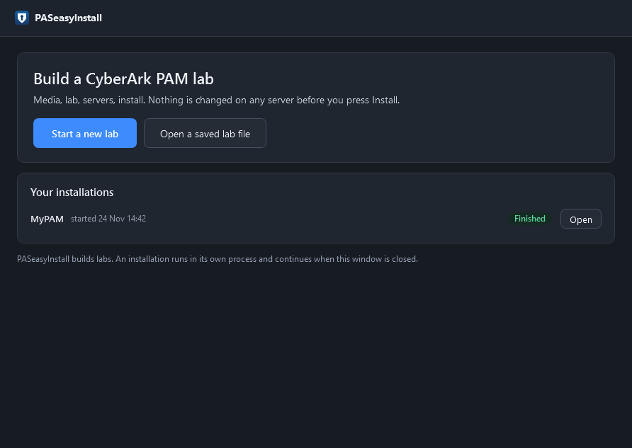
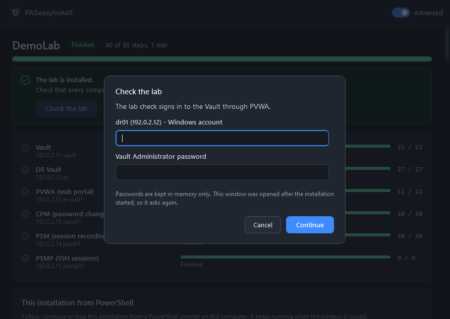

# The window

```powershell
Start-PASeasyInstall
```

One window builds a lab in four steps and then shows the installation while it runs. It is part of the
PASeasyInstall module and is drawn with WPF, which is part of Windows, so there is nothing else to install. The
window only calls the [commands](../commands/index.md) of the module: everything it does can also be done from
the prompt, and with **Advanced** on the Install step shows you how.

| Page | What you do there |
|---|---|
| [Start page](#start-page) | Start a new lab, open a saved lab file, open an installation |
| [1. Media](media.md) | Say where your CyberArk download, license and keys lie |
| [2. Lab](lab.md) | Choose the Vault and how many of each component |
| [3. Servers](servers.md) | Name the servers, enter accounts and passwords, have them checked |
| [4. Install](review.md) | Read the plan and press **Install the lab** |
| [The installation page](run.md) | Follow the installation, continue it when it stopped, check the lab |

The step line in the top bar shows where you are. Finished steps have a check mark and can be pressed to go
back to them; **Back** and **Next** are at the bottom of the window.

Nothing is changed on any server before you press **Install the lab** on step 4 and confirm.

## Start page


- **Start a new lab** begins with step 1.
- **Open a saved lab file** reads a lab file (JSON) saved on the Servers or Install step or written by
  `Export-PASLabConfiguration`. Its name, Vault choice, components, addresses and server names are filled in,
  and the window opens the Media step: media and passwords are entered again, because a lab file never
  contains them. `Start-PASeasyInstall -Config <file>` does the same when the window opens.
- **Your installations** lists the installations started from this computer, newest first, with the time they
  started and their state (*Installing*, *Finished*, *Stopped with an error*, *Stopped by you*, ...). **Open**
  shows the page of that installation.



The name **PASeasyInstall** in the top bar brings you back to this page from anywhere.

## The Advanced switch

The switch **Advanced** at the top right shows what most labs never need. It appears only on pages where it
changes something:

| Page | Advanced adds |
|---|---|
| Lab | *Use existing Vault (advanced)*, the Active Directory choices, and up to four of each component instead of two |
| Servers | Every single result of the server check, the address of this computer, "Who installs", the hardening switch, the PTA time zone |
| Install | The same lab as PowerShell commands |
| Installation page | The PowerShell commands for this installation, the activity log opened, and **Stop the installation** |

## An installation runs on its own

When you press Install, the installation starts in its own process on this computer. You can close the window.
Open it again later and the start page lists the installation.

While the window stays open, it remembers the accounts and passwords you typed for the installation it started.
They are kept in memory only, never in a file. For an installation you open later, the window asks again when it
needs them, for **Try this step again**, **Continue without repeating it** and **Check the lab**:



## Try it without servers

```powershell
Start-PASeasyInstall -Backend Mock
```

The same window with a simulated installer. It contacts no server and installs nothing, and a badge
**Simulation** in the top bar says so. Some lab names make it misbehave on purpose, so that you can try what
happens:

- a lab name that contains `unreach`: the server check finds a server that does not answer;
- a lab name that contains `fail`: the installation stops with an error, and continuing it finishes it;
- a lab name that contains `warn`: restart steps report a warning and go on.

## What was tested

The window has a self-test that presses its own buttons and saves every screen (see `Desktop/SelfTest.ps1` in
the repository). It was run with the simulated installer and with real servers. The folder and file pickers
are not part of the scripted walks. If something looks wrong, please
[report it](https://github.com/bigbatmanorg/PASeasyInstall/issues).
