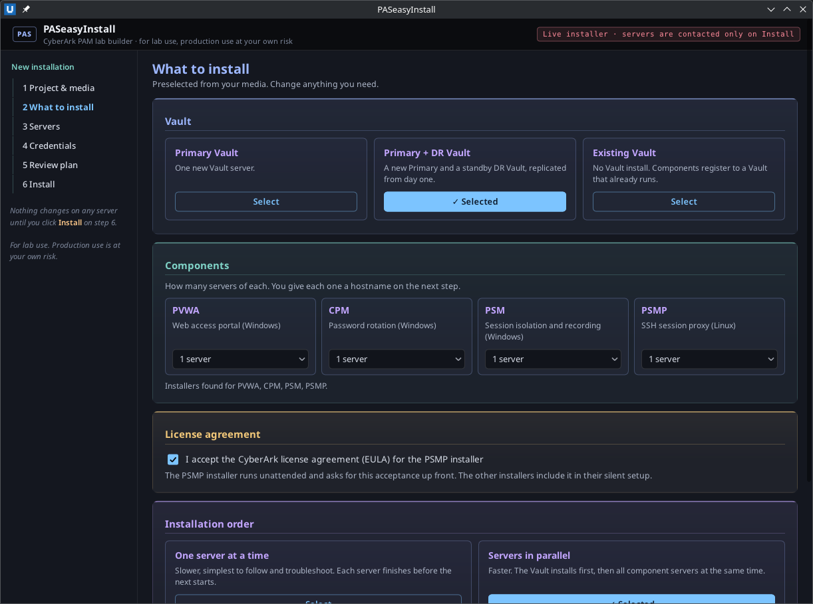

# Desktop UI

`Start-PASeasyInstall` (module **PASeasyInstall.UI**) opens a six-step desktop. You work through the steps in order, but you can go back to any
step at any time from the left-hand list. **Nothing is sent to any server until you click Install on step 6.**



*The header always shows whether the window drives the real installer or the Mock backend, and the lab notice.*

| Step | What you decide |
|---|---|
| [1 Project & media](project-media.md) | Environment name, where the project file goes, and the installer media |
| [2 What to install](what-to-install.md) | Primary, Primary + DR or Existing Vault; how many PVWA, CPM, PSM and PSMP servers |
| [3 Servers](servers.md) | Controller address, Vault address(es), and a hostname and address per component server |
| [4 Credentials](credentials.md) | Accounts, and either one lab password or individual passwords |
| [5 Review plan](review.md) | Every server, installer, dependency and security deviation, plus issues to fix |
| [6 Install](install.md) | Readiness check, Install, and live progress per server |

## Options

```powershell
Start-PASeasyInstall                          # the real installer (default, -Backend Live)
Start-PASeasyInstall -Config .\Lab01.json     # reopen a saved project
Start-PASeasyInstall -Backend Mock            # the same window with a simulated installation; no server is contacted
```

**Reopening a project** fills in the name, the Vault option, the addresses and the component servers from the project
file. Add the installer media and enter the passwords again: they are never stored in a project file.

The desktop only calls the [public commands](../commands/index.md) of the PASeasyInstall module. Everything it does
can also be done from the prompt.

The **Mock** backend is useful for demos, training and trying the flow without servers. Media, validation and plans are
real; only the installation is simulated, including a failure (put `fail` in the environment name).

## Lab mode password prefill

In Lab mode, the universal password field can be prefilled from the environment variable `PASEASY_LAB_PASSWORD`.
This is handy on a lab controller you use every day. Nothing is stored in PASeasyInstall itself.

```powershell
$env:PASEASY_LAB_PASSWORD = Read-Host 'Lab password'   # this PowerShell session only
Start-PASeasyInstall
```
