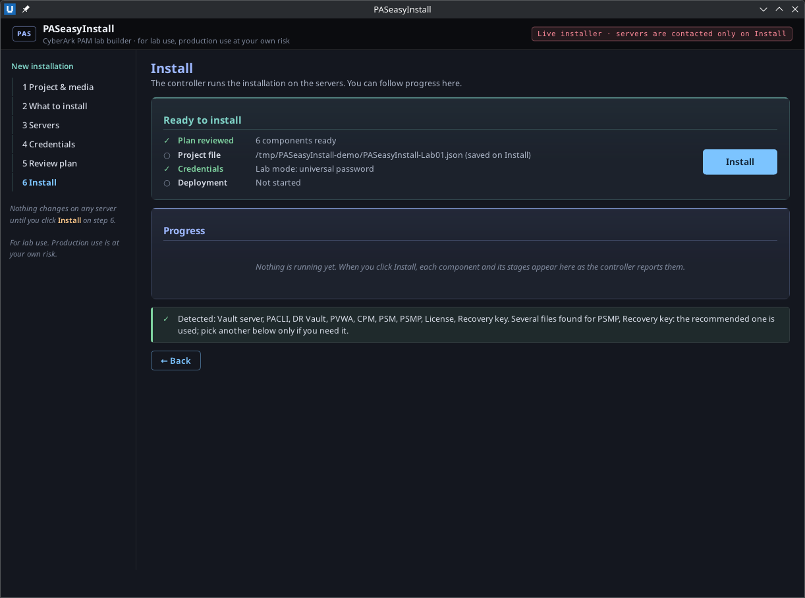
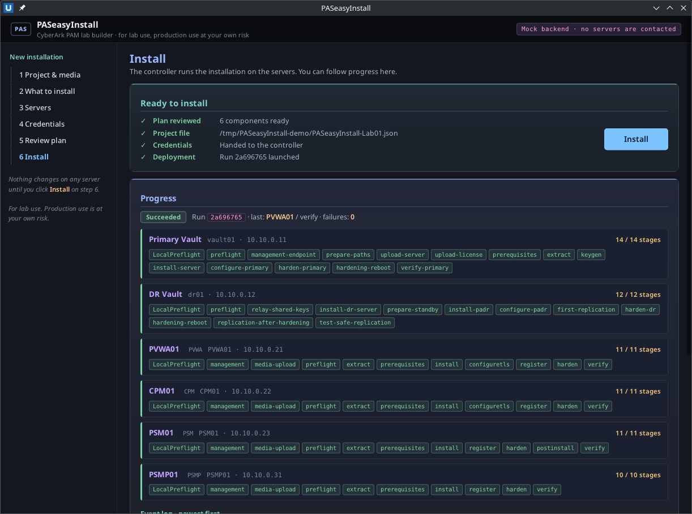
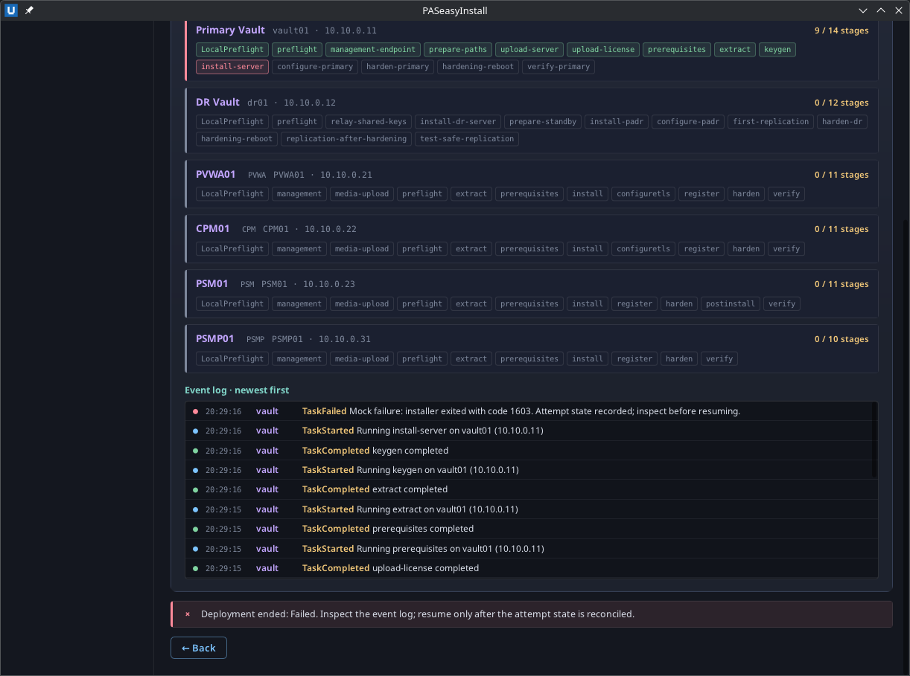

# 6 Install



## Ready to install

A short checklist next to the **Install** button: plan reviewed, project file, credentials, deployment. Install is
enabled once the plan has no blocking issues.

Clicking **Install**:

1. saves the project file;
2. hands the credentials, in memory, to a **detached controller process** on this computer;
3. starts the run: the Vault (and DR) first, then the component servers, one after the other.

Closing the window does **not** stop the installation. Follow it from the prompt with
[`Get-PASRun -RunId <run id>`](../commands/runs.md#get-pasrun) or `Wait-PASRun -RunId <run id>`.

## Progress



The **run id** is shown at the top. You need it at the prompt (`Get-PASRun`, `Resume-PASRun`). Below it is one card
per server, with a chip per stage that turns green when it completes, the current stage highlighted, and
`n / m stages`. Below it is the **event log**, newest first, read from the controller's event journals. There are no
estimated percentages: what you see is what the servers reported.

## When something fails



The failed stage turns red, and the event log shows the reason. Nothing new starts after a failure; the remaining
servers stay pending. The attempt's state on the server is recorded.

The window then shows the **commands to continue**, with the run id filled in:

```powershell
Resume-PASRun -RunId <run id>
Export-PASDiagnostics -RunId <run id> -Path <zip>
```

Read [Troubleshooting](../troubleshooting/index.md), fix the cause, then run
[`Resume-PASRun`](../commands/runs.md#resume-pasrun) at the prompt (add `-RetryStep <step>` to execute the failed
step again). If you will not continue the run, give it up with `Stop-PASRun -RunId <run id>`. Never reinstall blindly
over an uncertain attempt.

*The progress and failure screenshots use the Mock backend.*
