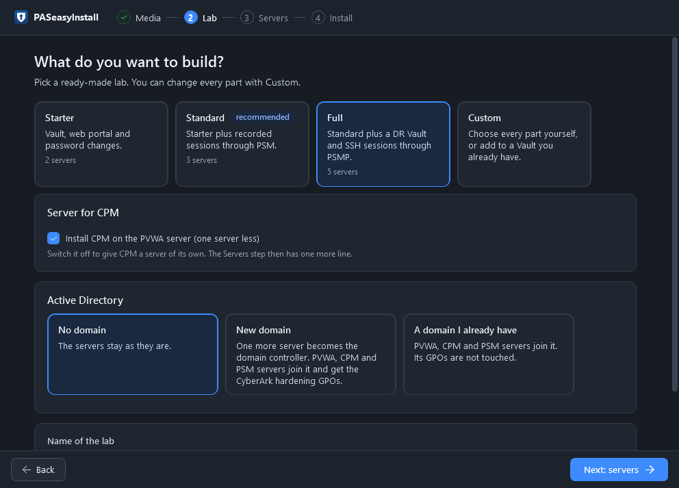
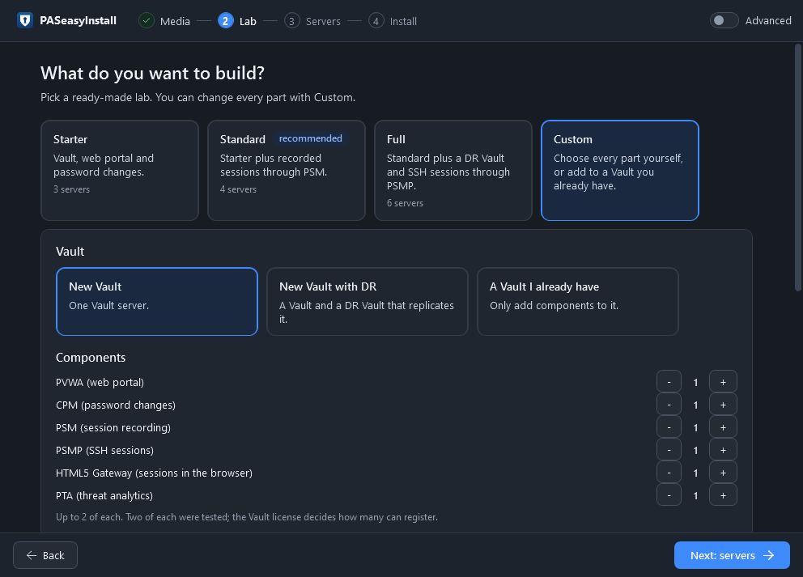
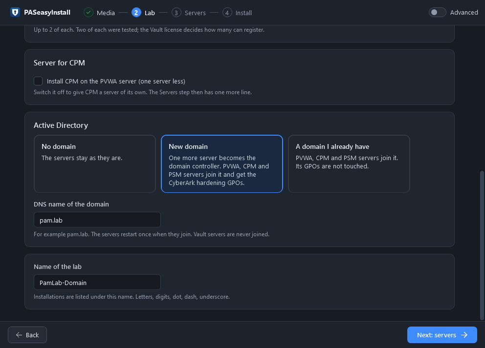

# Step 2: Lab

Choose what to build.

## Ready-made labs

| Lab | Installs | Servers |
|---|---|---|
| **Starter** | Vault, PVWA, CPM | 2 |
| **Standard** (recommended) | Starter plus PSM | 3 |
| **Full** | Standard plus a DR Vault and PSM for SSH | 5 |
| **Custom** | You choose every part | |

The number of servers on each card follows your choices below: CPM on its own server adds one.

## Custom

**Vault**

- **New Vault**: one Vault server.
- **New Vault with DR**: a Vault and a DR Vault that replicates it.
- **A Vault I already have**: only components are installed and registered with it. You enter its address on
  the Servers step.

**Components**: how many of PVWA, CPM, PSM, PSM for SSH, HTML5 Gateway and PTA. Up to two of each; with
**Advanced** switched on, up to four. Two of each were tested, and the Vault license decides how many can
register. Set a component to 0 to leave it out.

- An **HTML5 Gateway** shares the server of a PSM for SSH when there is one; otherwise it gets its own Linux
  server. It needs a PVWA in the same lab.
- **PTA** needs its own RHEL-family server with 8 GB, and a PVWA in the same lab.

## Server for CPM

In every lab, *Install CPM on the PVWA server (one server less)* is switched on. Switch it off to give CPM a
server of its own; the Servers step then has one more line. A CPM on its own server is installed at the same
time as PVWA.

## Active Directory

- **No domain**: the servers stay as they are.
- **New domain**: one more server becomes the domain controller of a new forest. The PVWA, CPM and PSM servers
  join it before they are installed (they restart once), and at the end the CyberArk hardening GPOs from the
  vendor packages are imported and applied to them. Enter the DNS name of the domain, for example `pam.lab`.
- **A domain I already have**: the PVWA, CPM and PSM servers join it. Nothing in that domain is changed, and its
  GPOs are not touched. On the Servers step you enter the address of one of its DNS servers and a domain account
  that may join computers.

Vault servers are never joined to a domain. More: [Active Directory](../components/ad.md).

## Name of the lab

Installations are listed under this name. Letters, digits, dot, dash and underscore.

Next: [Step 3: Servers](servers.md).
