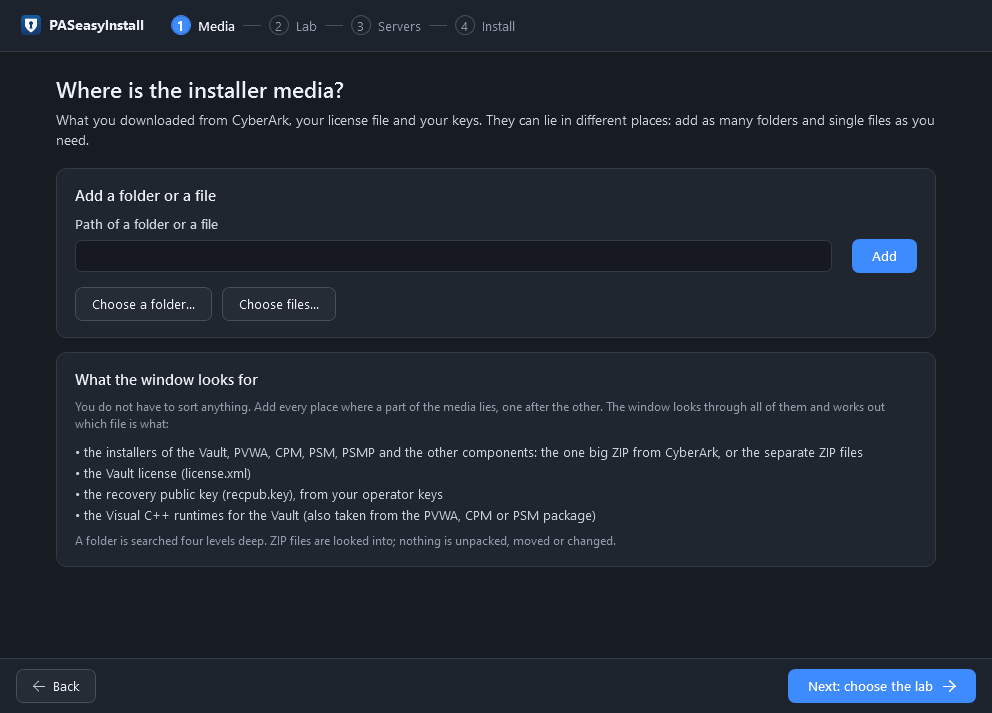
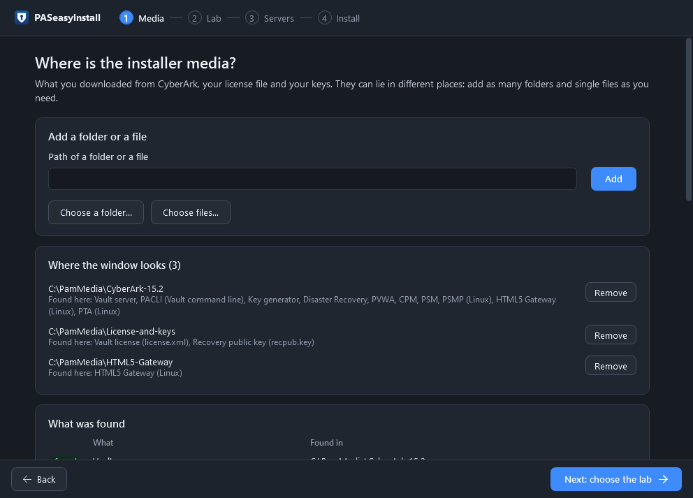
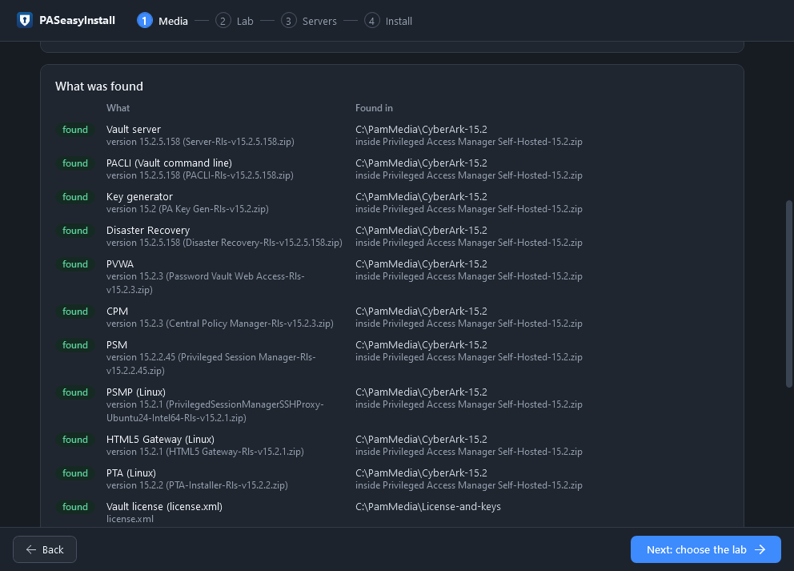

# Step 1: Media

Say where your CyberArk download, your license file and your keys lie.



## Add folders and files

- Type or paste the **path of a folder or a file** and press **Add**, or
- press **Choose a folder...** or **Choose files...** and pick them. Several files can be picked at once.

You do not have to sort anything, and nothing has to be in one folder or one ZIP. Add every place where a part
lies, one after the other, for example:

- the folder with the download from CyberArk (the one big ZIP, or the separate ZIPs);
- the folder with `license.xml`;
- the folder with your operator keys (`recpub.key`).

After every **Add** the window looks through all places again. That takes a few seconds; the window says
*Looking for installers* meanwhile and stays usable. A folder is searched four levels deep. ZIP files are looked
into. Nothing is unpacked, moved or changed.

There is no drag and drop: media is added by path.

## Where the window looks

Every place you added is listed with what was found in it. **Remove** takes a place out again. A path that does
not exist is marked, so that you can remove it and add the right one.



## What was found

Below the places, one line per part: what it is, its version and file name, and where it was found (the folder
or file, and the ZIP it lies inside).



The window looks for:

| Part | File |
|---|---|
| Vault server, PACLI, key generator, Disaster Recovery | from the big ZIP, or `Server-Rls-...zip`, `PACLI-Rls-...zip`, `Disaster Recovery-Rls-...zip` and `Vault Ansible Role-Rls-...zip` |
| PVWA, CPM, PSM | `Password Vault Web Access-Rls-...zip`, `Central Policy Manager-Rls-...zip`, `Privileged Session Manager-Rls-...zip` |
| PSM for SSH | `PrivilegedSessionManagerSSHProxy-<distribution>-Intel64-Rls-...zip` |
| HTML5 Gateway, PTA | `HTML5 Gateway-Rls-...zip`, `PTA-Installer-Rls-...zip` |
| Vault license | `license.xml` |
| Recovery public key | `recpub.key`, from your operator keys |
| Visual C++ runtimes for the Vault | `VC_redist.x64.exe`, `VC_redist.x86.exe`; also taken from the PVWA, CPM or PSM package |

When several versions of a part are found, the highest version is used.

## What is still missing

When a part the chosen lab needs was not found, a box names it: *Not found yet for the lab that is chosen*. Add
the folder or file that holds it, or leave that part out of the lab on the next step. You can go on with
**Next: choose the lab** at any time and come back with **Back**.

If nothing is recognised, the usual cause is an unpacked copy: add the folder with the ZIP files as downloaded
from CyberArk.

## From the prompt

```powershell
Get-PASMediaInventory -Path D:\CyberArk, D:\Licenses | Format-Table Component, Version, Name, Container
$media = Get-PASMediaInventory -Path D:\CyberArk, D:\Licenses | Get-PASMediaSelection
```

See [Media commands](../commands/media.md).

Next: [Step 2: Lab](lab.md).
