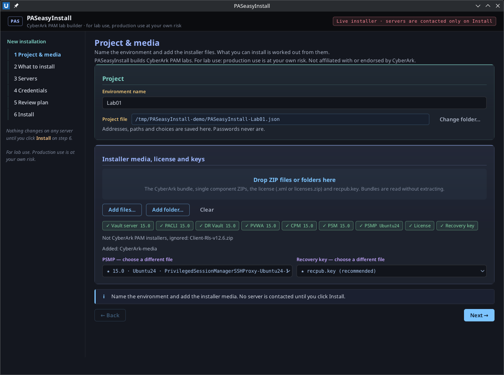

# 1 Project & media

## Project

- **Environment name.** A short name for this lab, for example `Lab01`. It names the project file, and it keeps
  this lab's runs and locks separate from other labs on the same controller.
- **Project file.** Shown live as `PASeasyInstall-<name>.json`. It defaults to the folder you started from;
  **Change folder…** moves it. It holds addresses, paths and choices. **Passwords are never saved.** The file is
  written when you click Install, and it can be replayed later with
  [`Invoke-PASeasyInstall`](../commands/invoke-paseasyinstall.md).

## Installer media, license and keys

Drop ZIP files or folders on the drop zone, or use **Add files…** / **Add folder…**. PASeasyInstall recognises
components by file name:

- **The CyberArk bundle ZIP.** Its contents are listed in place, without extracting it. Only the installers you
  select are extracted later, on the controller.
- **Single component ZIPs:** Server, PACLI, Disaster Recovery, PVWA, CPM, PSM, and PSMP per Linux distribution.
- **The license** (`license.xml`, or a ZIP containing it) and the **public recovery key** `recpub.key`.

Each detected component gets a green chip. Files that are not CyberArk PAM installers are listed as ignored.

When several candidates exist, a dropdown appears. Examples: PSMP builds for Ubuntu 24, Ubuntu 22, RHEL 8/9 and
SLES; several licenses. The recommended file is preselected: the highest version, and for PSMP Ubuntu 24 first. A plain
file wins over the same installer inside the bundle.

VC++ redistributables in the same folder are picked up automatically as prerequisites.

!!! tip
    Keep one media folder per CyberArk version, for example `C:\CyberArk\media\15.0`, and add the whole folder.
