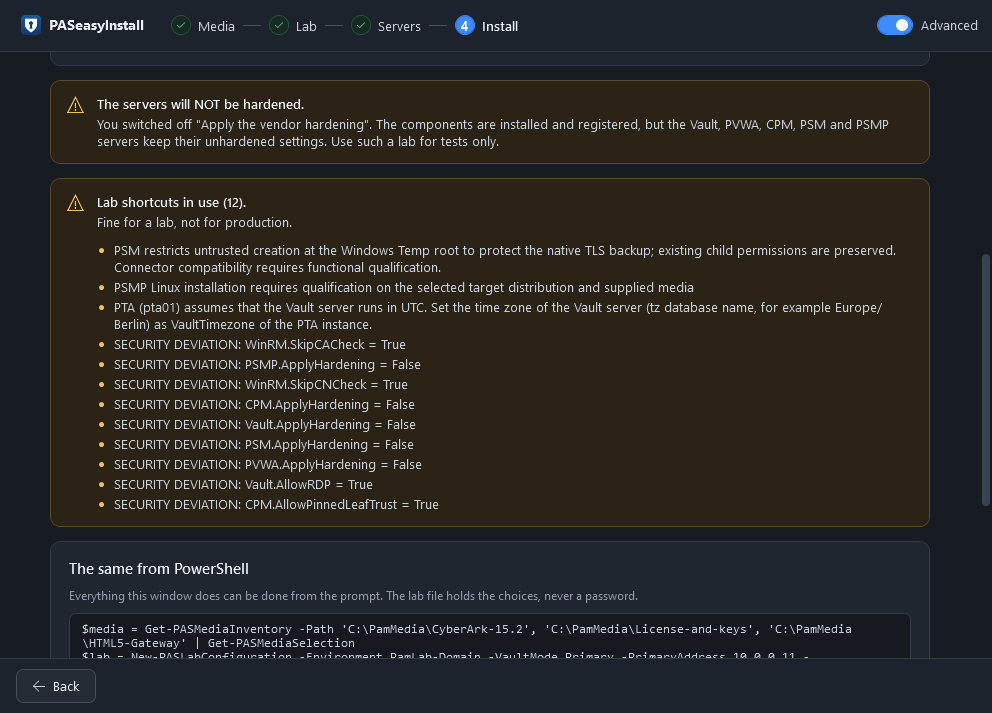

# Step 4: Install

Read what will be installed, then press Install. Until you press it and confirm, nothing is changed on any
server.

## The plan

One line per component: what it is, on which server, and which installer file is used. The line at the top says
how long the installation takes, roughly.

The numbers are the order of the plan, not a waiting line: the servers are installed at the same time
([Servers at the same time](../concepts/parallel.md)).

If the plan has problems, they are listed in plain words and the **Install the lab** button stays disabled until
they are solved. Go **Back**, correct the entry and come here again.

## Lab shortcuts in use

What this lab relaxes compared with a production installation, for example self-signed certificates or remote
desktop to the Vault from this computer. They are fine for a lab and not for production. Each one is explained
on [Lab and Secure profiles](../concepts/profiles.md). The window always uses the Lab profile.

If you switched off *Apply the vendor hardening* on the Servers step, a box above the shortcuts says so:

## Advanced: the same from PowerShell

With **Advanced** on, a card shows the commands that build the same lab from the prompt, and **Save the lab
file** writes the lab as a JSON file. The file holds your choices, never a password. Open it again with
**Open a saved lab file** on the start page, with `Start-PASeasyInstall -Config <file>`, or install it with
`Install-PASLab -Path <file>`.

## Install the lab

**Install the lab** asks once more before it starts. The question names the number of servers, and it repeats
the warning when the servers will not be hardened.

After **Install** the window stays usable while the installation is started (that takes up to a minute or two:
the installers are checked and the servers are asked once more whether they answer). Then the
[installation page](run.md) opens.

An installation cannot be undone from the window. To start again, reset the servers to their clean state.
