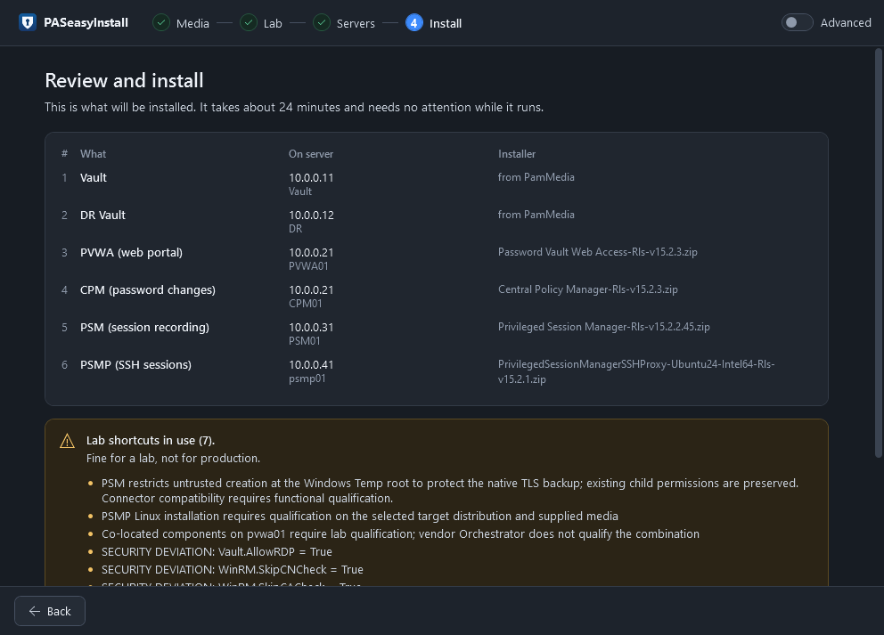
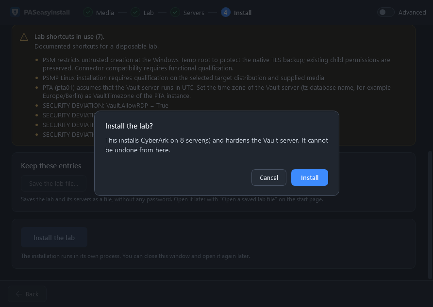

# Step 4: Install

*Review and install.* Read what will be installed, then press **Install the lab**. Until you press it and
confirm, nothing is changed on any server.

## The plan

The line at the top says roughly how long the installation takes. Below it, one line per component: its
number, what it is, on which server (address and name), and which installer file is used.

The numbers are the order of the plan, not a waiting line: the servers are installed at the same time
([Servers at the same time](../concepts/parallel.md)).

If the plan has problems, the page says *The plan has problems. Nothing can be installed until they are solved*
and lists them under **To solve**; there is no Install button then. Go **Back**, correct the entry and come here
again.

## Lab shortcuts in use

What this lab relaxes compared with a production installation, for example self-signed certificates or remote
desktop to the Vault from this computer. They are fine for a lab and not for production. The box is collapsed:
its title says how many shortcuts there are, and **Show the list** opens it. Each one is explained
on [Lab and Secure profiles](../concepts/profiles.md). The window always uses the Lab profile.

If you switched off *Apply the vendor hardening* on the Servers step, a box above the shortcuts says so:

## Save the lab file

The card **Keep these entries** has **Save the lab file...**: it writes the lab and its servers as a JSON file,
without any password. Open it again with **Open a saved lab file** on the start page, with
`Start-PASeasyInstall -Config <file>`, or install it from the prompt with `Install-PASLab -Path <file>`.

With **Advanced** on, the card **The same from PowerShell** takes its place: it shows the commands that build the
same lab from the prompt, with the same save button below them.

## Install the lab

**Install the lab** asks once more before it starts (*Install the lab?*). The question names the number of
servers, and it repeats the warning when the servers will not be hardened.

After **Install** the window says *Starting the installation...* and stays usable while the installer checks
the plan and the installer files and starts its own process. Then the [installation page](run.md) opens.

An installation cannot be undone from the window. To start again, reset the servers to their clean state.
