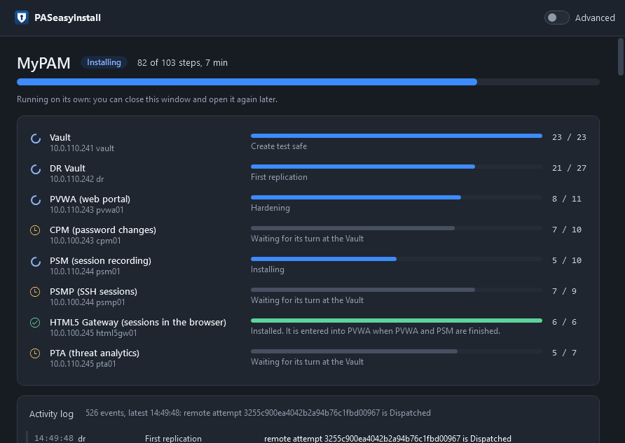
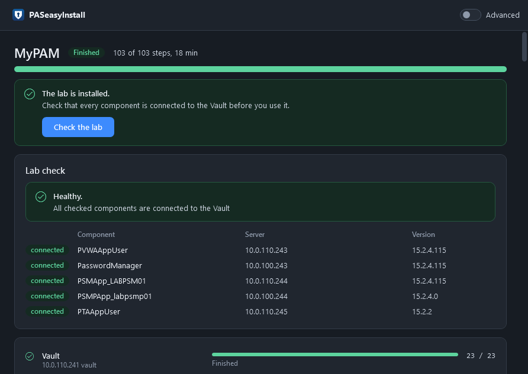
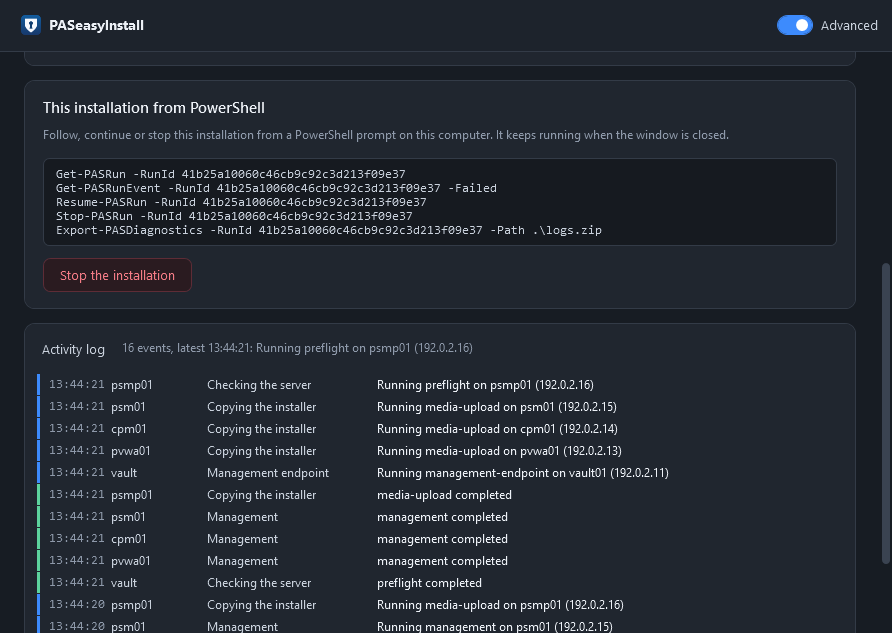

# The installation page

Every installation has a page. It opens when you press Install, and again when you **Open** an installation on
the start page. The installation itself runs in its own process: close the window whenever you like
(*Running on its own: you can close this window and open it again later*).

## What you see

- **The headline:** the name of the lab, its state, how many steps are done of how many, and how long it has
  been running, with a progress bar.
- **One line per component:** its server, a progress bar, the step it is on, and steps done of steps in all.
  A server that joins a domain has a line *Joining the domain* of its own.
- **Several components work at once.** A server does everything that needs no other server straight away.
- **Waiting for its turn at the Vault:** the component is ready to sign in to the Vault (to register). It
  waits until the Vault is installed, and then for the components before it, because only one may sign in to
  the Vault at a time. The order is PVWA, CPM, then PSM and PSMP; PTA comes last.
- **Waiting for PVWA:** a component that has to trust the PVWA certificate (CPM, PSM, the HTML5 Gateway or PTA
  on another server) starts when PVWA has created it, shortly after the start.
- **Waiting for the Primary Vault:** the DR Vault waits for the keys of the Primary Vault, and later for the
  Primary Vault to be ready.
- **Waiting:** the component has not started yet. On a server with two components the second one waits for the
  first.
- **Activity log:** press it to unfold every event of the installation, the newest first: time, component,
  step and message. Folded, it shows the number of events and the latest one.

PSM restarts its server several times, PTA restarts its server once after the installation, and a server that
joins a domain restarts once. That is expected.

An HTML5 Gateway is installed early, because it needs no Vault. Its line then says *Installed. It is entered
into PVWA when PVWA and PSM are finished*: that entry is made on the PVWA server near the end, after PVWA, PSM
and PTA are finished.

## When it stopped { #stopped }

The red box *The installation stopped* names the step and the component (*It stopped at "..." of ...*) and shows
the installer's own error text. A server that fails stops only what depends on it: every other server is
installed to the end, and a server that could not go on says *Not continued: a server it depends on failed*
(see [Servers at the same time](../concepts/parallel.md#when-a-server-fails)). Nothing is undone.

The buttons appear when the run has ended: the other servers finish first, and the line of the failed server
says so meanwhile. **Try this step again** and **Continue without repeating it** leave every server that is
installed and verified as it is. Only the server that stopped is started again: its finished steps are looked
at once (*Checking what is already installed*), then the failed step runs.

Look at the server and correct the cause. Then:

| Button | What it does |
|---|---|
| **Try this step again** | Runs the failed step again, then continues the installation. Use it when you corrected the cause. |
| **Continue without repeating it** | Continues the installation without running the failed step again. Finished steps are only checked. Use it when the step did finish on the server after all. |
| **Save the logs as a ZIP** | Writes the journals of the installation into a ZIP without passwords, for a bug report. |

A failed step is never repeated on its own. That is on purpose: an installer whose outcome is not known must
not simply run twice.

If the window was closed in between, it asks for the accounts and passwords again before it continues.

## When it finished

*The lab is installed.* **Check the lab** signs in to the Vault through PVWA and lists the components the Vault
sees, each *connected* or *not connected*, with its server and version. With a DR Vault it also asks for the
account of the DR server and looks at the replication. It changes nothing.

*Healthy* means every component of the lab is connected to the Vault. Otherwise *Not healthy yet* lists what is
wrong; see [Troubleshooting](../troubleshooting/index.md#a-component-is-not-connected-in-the-lab-check).

Then open the web portal at `https://<computer name of the PVWA server>/PasswordVault` and sign in as
`Administrator` with the Vault Administrator password. In a lab the certificate is self-signed, and the computer
with the browser must resolve the PVWA name (a hosts entry is enough).

## Advanced: PowerShell commands and Stop

With **Advanced** on, the card **This installation from PowerShell** shows the commands for this installation,
with its run id filled in: look at it, list what failed, continue it, stop it, save the logs. The activity log
is unfolded.

While the installation runs, the card also has **Stop the installation**. After you confirm, the window ends the
installation as `Stop-PASRun -RunId <run id> -Force` does.

A step that is running on a server at that moment is not interrupted, the servers keep what was installed until
then, and the locks on the servers stay. A stopped installation (*Stopped by you*) cannot be continued: restore the servers (for example from a snapshot)
before you install them again; see
[`Stop-PASRun`](../commands/runs.md#stop-pasrun).

The commands are explained in [Run commands](../commands/runs.md).
