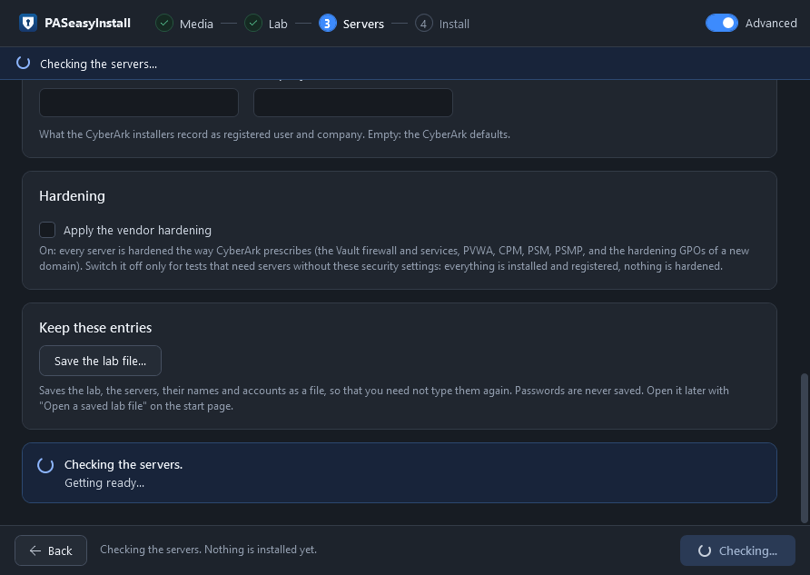

# Step 3: Servers

Name the servers, enter the accounts and passwords, and have the servers checked.

## The servers

One line per server the lab needs, in the order they are installed. The servers must be freshly installed
machines this computer can reach: Windows with WinRM over HTTPS, Linux with SSH
([Server prerequisites](../servers/prerequisites.md)).

| Field | What to enter |
|---|---|
| **Computer name** | The name the server already has. PVWA is reached under this name later (`https://<name>/PasswordVault`). Not needed for Vault servers. |
| **Address** | The IPv4 address of the server. Components that share a server are one line. |
| **Account** | A local administrator on Windows (`Administrator`), `root` on Linux. |
| **Password** | The password of that account. |

With a new domain there is one more line for the server that becomes the domain controller. With a domain you
already have, that line takes the address of one of its DNS servers and a domain account that may join
computers.

## The Vault passwords

- **New Vault:** the passwords to set for the Vault users **Administrator** and **Master**, and with a DR Vault
  the password of the user the DR Vault replicates with.
- **A Vault you already have:** its address and the password of its Administrator.

With PSM for SSH, an HTML5 Gateway or PTA in the lab you also accept the CyberArk end user license agreement of
the Linux installers here.

Passwords are kept in memory only, never in a file.

## Save what you entered

**Save the lab file...** (below the form) writes the lab, the servers, their names and accounts to a file, so
that you need not type them again. No password is saved, and no server is contacted. Open the file later with
**Open a saved lab file** on the start page: the form is filled in, and you enter only the media folder and the
passwords. The same button is on the Install step.

## Next checks the servers

**Next: check the servers** changes nothing on any server. The button is disabled at once and a message says
which part is running:

1. **Part 1 of 2**, a few seconds: does every server answer at its address?
2. **Part 2 of 2**, up to a minute per server: can the account sign in, and is the server ready (operating
   system, free disk space, no pending restart)?

- If entries are missing, a box lists them and nothing is checked.
- A server that does not answer, or an account that cannot sign in, is named with the reason. Correct it and
  press Next again.
- Only when every server passed, the Install step is shown.

A wrong root password of a Linux server is found here too: the check signs in the way the installation will.
It also looks at what the server is: a server for PTA must be RHEL, Rocky or Alma with 8 GB, and the check says
so when it is something else.

## Advanced

| Card | What it is for |
|---|---|
| **Every check** | After the server check: one line per check and server, with its result. |
| **Network** | The address of this computer as the Vault sees it. The firewall of the hardened Vault is opened for this address only. The window fills in the address it found; change it when this computer has several. |
| **Who installs** | The user name and company the CyberArk installers record. Empty: the CyberArk defaults. |
| **Hardening** | *Apply the vendor hardening*, on by default. See below. |
| **PTA** | The time zone of the Vault server as a tz database name, for example `Europe/Berlin`. Empty: UTC. Only with PTA in the lab. |

### Installing without hardening

With *Apply the vendor hardening* switched **on**, every server is hardened the way CyberArk prescribes: the
Vault (firewall and services), PVWA, CPM, PSM, PSM for SSH, and the hardening GPOs of a new domain.

Switch it **off** only for tests that need servers without these security settings. Everything is installed and
registered, nothing is hardened. The Install step and the confirmation before the installation then say
**The servers will NOT be hardened**. It cannot be switched on afterwards for an installed lab from here.
More: [Lab and Secure profiles](../concepts/profiles.md#installing-without-hardening).

Next: [Step 4: Install](review.md).
