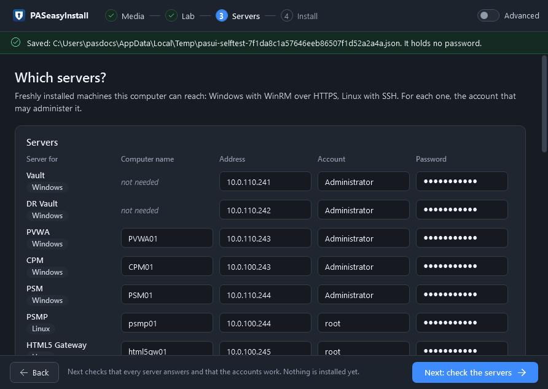
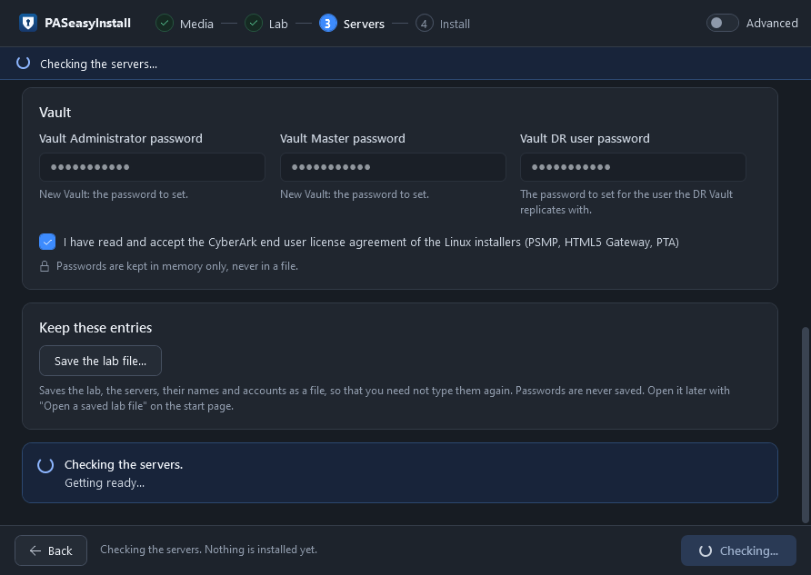

# Step 3: Servers

*Which servers?* Name the servers, enter the accounts and passwords, and have the servers checked.

## The servers

The card **Servers** has one line per server the lab needs, in the order they are installed. The servers must be
freshly installed machines this computer can reach: Windows with WinRM over HTTPS, Linux with SSH
([Server prerequisites](../servers/prerequisites.md)).

| Column | What to enter |
|---|---|
| **Server for** | What the server becomes, for example *PVWA + CPM*, *PSMP + HTML5 Gateway* or *PTA (RHEL family, 8 GB)*, with Windows or Linux below it. Components that share a server are one line. |
| **Computer name** | The name the server already has. PVWA is reached under this name later (`https://<name>/PasswordVault`). *not needed* for the Vault servers. The field starts with a default (`PVWA01`, `psmp01`, ...): replace it with the real name. |
| **Address** | The IP address (or DNS name) of the server. Every server needs its own. |
| **Account** | A local administrator on Windows (default `Administrator`), `root` on Linux. |
| **Password** | The password of that account. |

With a new domain there is one more line, **Domain controller**: the server that becomes the domain controller.
Its administrator becomes the administrator of the new domain, with the same password, and that password is
also set as the restore mode password of the domain. With a domain you already have, the line **Existing domain
(a DNS server of it)** takes the address of one of its DNS servers and a domain account that may join
computers.

## The Vault passwords

The card **Vault**:

- **New Vault:** *Vault Administrator password* and *Vault Master password*, the passwords to set for the Vault
  users Administrator and Master; with a DR Vault also *Vault DR user password*, for the user the DR Vault
  replicates with. Letters, digits and the usual signs, no space and no double quote.
- **Use existing Vault:** *Address of the Vault you already have* and *Password of the Vault user
  Administrator* (the password it has now).

With PSMP, an HTML5 Gateway or PTA in the lab, tick **I have read and accept the CyberArk end user license
agreement of the Linux installers (PSMP, HTML5 Gateway, PTA)**.

Passwords are kept in memory only, never in a file.

## Keep these entries

**Save the lab file...** writes the lab, the servers, their names and accounts to a file, so that you need not
type them again. No password is saved, and no server is contacted. Open the file later with **Open a saved lab
file** on the start page: the form is filled in, and you add the media and enter the passwords again. The same
button is on the Install step.

## Next checks the servers

**Next: check the servers** changes nothing on any server. Missing or wrong entries are listed first, and
nothing is checked until they are corrected. Then the button says *Checking...* and a box says which part is
running:

1. **Part 1 of 2**, a few seconds: does every server answer at its address?
2. **Part 2 of 2**, up to a minute per server: can the account sign in, and is the server ready (operating
   system, free disk space, no pending restart, and more)?

- When a server does not answer, part 2 is not run.
- *The servers are not ready* lists every problem with its server and the reason. Correct it and press Next
  again.
- When every server passed (*All servers answered and look ready*), the Install step is shown.

A wrong root password of a Linux server is found here: the check signs in the way the installation will. It also
looks at what the server is: a server for PTA must be of the RHEL family with 8 GB of memory, and the check
says so when it is not.

## Advanced

| Card | What it is for |
|---|---|
| (the check result) | After the server check: one line per check and server, with its result. |
| **Network** | *Address of this computer* as the Vault sees it. The firewall of the hardened Vault is opened for this address only. The window fills in the address it found; change it when this computer has several. |
| **Who installs** | *User name* and *Company* that the CyberArk installers record. Empty: the CyberArk defaults. |
| **Hardening** | **Apply the vendor hardening**, on by default. See below. |
| **PTA** | *Time zone of the Vault server* as a tz database name, for example `Europe/Berlin`. PTA reads the times in the Vault audit with it. Empty: UTC. Only with PTA in the lab. |

### Installing without hardening

With **Apply the vendor hardening** switched on, every server is hardened the way CyberArk prescribes: the
Vault (firewall and services), PVWA, CPM, PSM, PSMP, and the hardening GPOs of a new domain.

Switch it off only for tests that need servers without these security settings. Everything is installed and
registered, nothing is hardened. The Install step and the question before the installation then say
**The servers will NOT be hardened**. It cannot be switched on afterwards for an installed lab.
More: [Lab and Secure profiles](../concepts/profiles.md#installing-without-hardening).

Next: [Step 4: Install](review.md).
