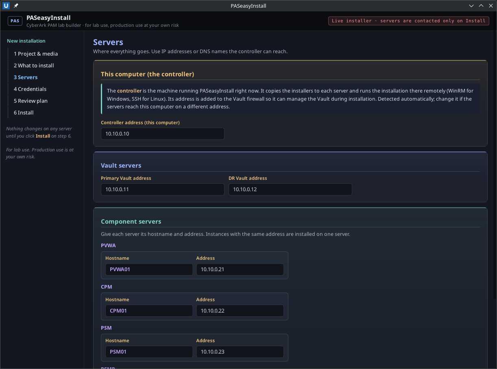

# 3 Servers

## This computer (the controller)

The **controller** is the machine running PASeasyInstall. It copies the installers to each server and runs the
installation there remotely: WinRM over HTTPS for Windows, SSH for Linux. Its address is detected automatically.

!!! warning "Use the address the servers see"
    The hardened Vault accepts management connections **only from this address**. If the servers reach the
    controller on a different address (NAT, a second network card), enter that one. Never enter a gateway or router
    address.

## Vault servers

The **Primary Vault address** and, for Primary + DR, the **DR Vault address**. For **Existing Vault**, the address of
the Vault the components should register to.

## Component servers

For every instance chosen on step 2, enter a **Hostname** and an **Address** (IP address or DNS name). The defaults
are `PVWA01`, `CPM01`, `PSM01`, `PSMP01`, and so on. Instances with the same address are installed on one server, which
is named after its first instance.
