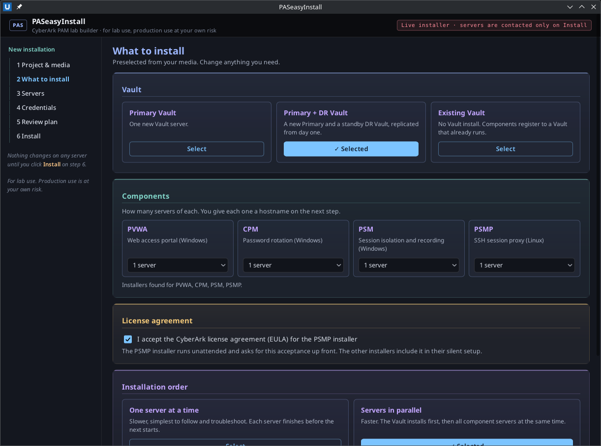

# 2 What to install

## Vault

| Option | What happens |
|---|---|
| **Primary Vault** | One new Vault server. |
| **Primary + DR Vault** | A new Primary and a standby DR Vault, installed together and replicated from day one. Replication is verified with a test Safe. |
| **Existing Vault** | No Vault installation. The components register to a Vault that already runs. You enter its address on the next step. |

!!! note
    A DR Vault can only be added together with a **new** Primary. Attaching DR to an existing Primary is not supported.

## Components

Choose how many servers of each component to install: **PVWA**, **CPM**, **PSM** (Windows) and **PSMP** (Linux),
up to four each. The counts are preselected from the media you added. You name each server on the next step. Giving
two instances the same address installs them on one server (co-location, for example PVWA and CPM together).

## License agreement

When PSMP is selected, accept the CyberArk EULA here. The PSMP installer runs unattended and requires the acceptance
up front. The other installers include it in their silent setup.

## Installation order

| Order | Behaviour |
|---|---|
| **One server at a time** | Slower, and simplest to follow and troubleshoot. Each server finishes before the next starts. |
| **Servers in parallel** | Faster. The Vault (and DR) installs first, then PVWA, then the other component servers (CPM, PSM, PSMP) at the same time. PVWA comes first because its registration creates the Vault objects the other components register against. |

Either way, registering components with the Vault is coordinated, so registrations never collide. CPM waits for the
PVWA whose certificate it trusts.
