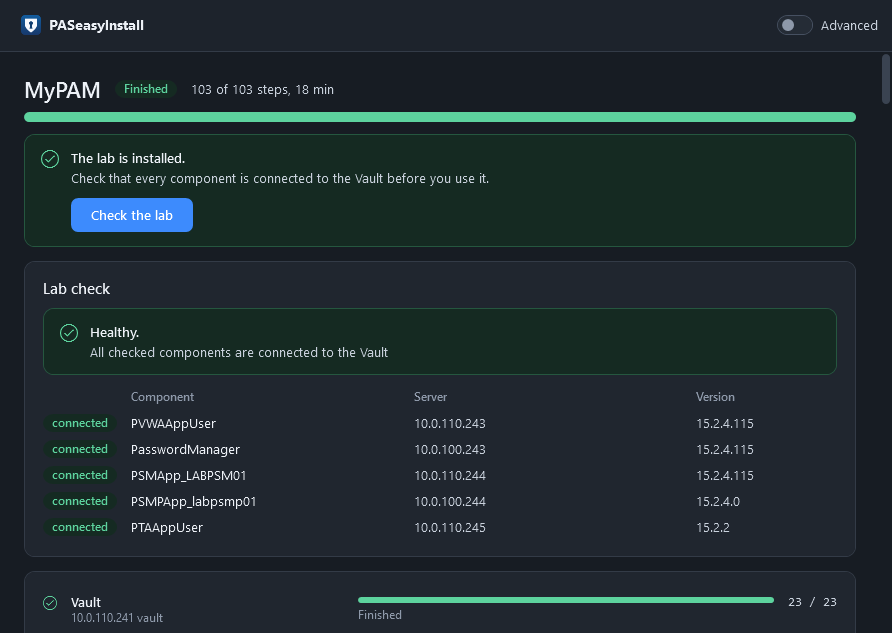

---
hide:
  - navigation
  - toc
---

# PASeasyInstall

**Builds a CyberArk PAM self-hosted lab on servers you provide, from one Windows computer.** Point it at your
CyberArk installer media, name the servers and press **Install**. It installs, registers, hardens and checks a
Vault (or a Primary and DR pair), PVWA, CPM, PSM, PSM for SSH, and optionally the HTML5 Gateway, PTA and an Active
Directory domain. Use the window, or one PowerShell command per step.

!!! warning "Made for labs"
    Training, demos, proofs of concept, testing upgrades and integrations. Production use is at your own risk.
    PASeasyInstall is a community project. It is **not affiliated with, endorsed by or supported by CyberArk**.
    You supply your own licensed CyberArk media and license. [What "lab" means here](lab-first.md)

## Start here

-   **[What you need](getting-started/requirements.md)**

    One Windows computer, empty servers it can reach, and your CyberArk download.

-   **[Install PASeasyInstall](getting-started/index.md)**

    `Install-Module PASeasyInstall`, or a portable ZIP that installs nothing.

-   **[Your first lab](getting-started/first-lab.md)**

    From empty servers to a running lab, step by step, with the window or from the prompt.

-   **[The window, page by page](gui/index.md)**

    Every screen with a picture: what to enter and what happens when you press Next.

## What it installs

| Component | Server | |
|---|---|---|
| [Vault](components/vault.md) | Windows Server 2022, not in a domain | A new Primary Vault, hardened |
| [DR Vault](components/dr.md) | Windows Server 2022, not in a domain | Together with a new Primary Vault; replication verified with a test safe |
| [PVWA](components/pvwa.md) | Windows Server 2022 | The web portal, with HTTPS |
| [CPM](components/cpm.md) | Windows Server 2022 | On the PVWA server or on its own |
| [PSM](components/psm.md) | Windows Server 2022 | The vendor's restarts are handled for you |
| [PSM for SSH](components/psmp.md) | Ubuntu 22.04/24.04, RHEL/Rocky 8/9 | |
| [HTML5 Gateway](components/html5gw.md) | Linux with Docker or Podman | Can share the PSM for SSH server |
| [PTA](components/pta.md) | RHEL/Rocky/Alma 8/9 with 8 GB | Registered with the Vault and PVWA |
| [Active Directory](components/ad.md) | Windows Server 2022 | A new domain, or joining one you have |

## How an installation runs

- **Nothing happens before Install.** Finding media, planning and checking the servers change nothing.
- **The servers are installed at the same time.** Only the steps that sign in to the Vault wait: until the Vault
  is installed, and then one at a time (PVWA, CPM, PSM and PSM for SSH, PTA last). A lab of nine servers with a
  DR Vault, PTA and the HTML5 Gateway took about 19 minutes in the test lab.
  [Servers at the same time](concepts/parallel.md)
- **An installation survives.** It runs in its own process and every step is recorded on the server. Close the
  window, restart the controller: the run goes on or is continued. A failed step is never repeated on its own.
  [Runs and resume](concepts/durable-runs.md)
- **Passwords stay in memory.** They are never written to a lab file, a log or a command line.
  [Security](concepts/security.md)
- **One module, nothing else.** Windows PowerShell 5.1 is enough. The window is drawn with WPF, which is part of
  Windows.

## What was tested

CyberArk PAM Self-Hosted 15.0 and 15.2 on Windows Server 2022, Ubuntu 24.04 and Rocky Linux 9, always with the
**Lab** security profile, on real servers from clean operating systems. The window was tested by walking it with
real installations; the pictures on these pages are screens of such a run. The `Secure` profile of the commands is
not qualified. The lab test record is in the repository:
[Docs/VALIDATION.md](https://github.com/bigbatmanorg/PASeasyInstall/blob/main/Docs/VALIDATION.md).

**Next:** [What you need](getting-started/requirements.md) · [Your first lab](getting-started/first-lab.md) ·
[Commands](commands/index.md) · [Troubleshooting](troubleshooting/index.md) · [Release notes](release-notes.md)
